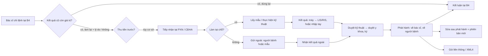

# Luồng tham chiếu: cận lâm sàng ngoại trú (chỉ định → thực hiện → kết quả → trả)

> Kiểm tra lần cuối: 2026-10-27 · Áp dụng: phòng khám có xét nghiệm/CĐHA/thăm dò chức năng tại chỗ hoặc gửi ngoài; khoa khám bệnh BV · Luật liên quan: CLS, MA-LT, BHYT-DATA, BHYT-GD, DLCN, BAOMAT-CB, EMR, TC-MS · Nhãn: xem `../variation-points.md`

Luồng tham chiếu, không phải luồng của cơ sở nào. Điểm nối với `ngoai-tru.md`: chỉ định sinh ra ở B4, kết quả quay về B4 để bác sĩ kết luận. Thu tiền và hóa đơn chi tiết ở `vien-phi-bhyt.md`.

Nguồn cho phần `[THÔNG LỆ]`: tiêu chí TT 54/2017 (khung tự đánh giá, NÊN), QĐ 2429/2017 tiêu chí chất lượng PXN (QĐ hành chính), kinh nghiệm triển khai. Phần liên thông kết quả CLS giữa cơ sở (mốc 01/01/2027) đang là dự thảo: mọi con số về thời hạn giá trị đều `BẮT BUỘC?`.

## Sơ đồ tham chiếu

Lượt BHYT: **chi phí đầu tiên của lượt** (thường là tiền khám hoặc dịch vụ CLS đầu tiên) kích hoạt check-in XML0 (`BHYT-DATA-R03`), nên bước D là nơi hay lộ lỗi "quên check-in".

## Các bước

### C1 — Chỉ định
- **Vai**: bác sĩ khám; điều dưỡng hỗ trợ.
- **Đầu vào → ra**: chẩn đoán sơ bộ + lịch sử CLS → phiếu chỉ định (dịch vụ theo danh mục, ưu tiên, ghi chú lâm sàng, lý do chỉ định lại nếu có).
- `[LUẬT]`:
  - Chỉ định trong phạm vi chuyên môn được duyệt của cơ sở và người hành nghề (`MA-LT-R14`).
  - Dịch vụ phải ánh xạ được ba lớp mã: nội bộ ↔ TT 23 ↔ mã DVKT BHYT, và chỉ số CLS theo QĐ 1227 (`MA-LT-R15`, `MA-LT-R16`, `BHYT-DATA-R17`).
  - Cảnh báo kết quả cùng loại còn thời hạn giá trị, hiển thị lịch sử chụp; chỉ định lại phải ghi lý do (`CLS-R03`, `CLS-R06`, cả hai `BẮT BUỘC?` vì chờ thông tư; TT 59/2025/TT-BKHCN Đ32 "tham khảo lần khám trước" đã có hiệu lực).
  - Kỹ thuật dùng bức xạ: ghi tình trạng thai/cho con bú với nữ tuổi sinh đẻ, hiện lịch sử chụp (`CLS-R22`).
  - Dịch vụ theo yêu cầu/ngoài phạm vi BHYT: thông báo trước, lưu xác nhận (`BHYT-GD-R35`).
  - Chỉ định trong HSBA phải khớp với kết quả và đơn thuốc sau đó (`DUOC-R10` nhắc chiều ngược lại).
- `[THÔNG LỆ]`: BV: chỉ định theo "gói" theo chuyên khoa hoặc theo phác đồ nội bộ; PK tư: bác sĩ chọn từng dịch vụ, hay có danh sách "hay dùng" theo bác sĩ. Chẩn đoán sơ bộ ghi trước khi chỉ định (thông lệ, để giám định BHYT không hỏi "chỉ định không có chẩn đoán").
- `[HỎI]`: VP-CLS-01 (dịch vụ nào tại chỗ, dịch vụ nào gửi ngoài), VP-CLS-04 (thói quen xem kết quả cũ, lý do chỉ định lại). Thêm: có bộ chỉ định mẫu theo bác sĩ/chuyên khoa không? Ai được sửa/hủy chỉ định sau khi đã thu tiền? Chỉ định "thêm sau" khi đang làm (reflex test) ai duyệt?
- **Dấu hiệu lệch chuẩn**: chỉ định dịch vụ không có trong danh mục được duyệt; dịch vụ không có mã BHYT nhưng vẫn kê vào lượt BHYT; chỉ định lại không lý do; không có chẩn đoán kèm chỉ định.

### C2 — Thu tiền trước / xác nhận quyền lợi (tùy cơ sở)
- **Vai**: thu ngân; tiếp đón.
- **Đầu vào → ra**: phiếu chỉ định → phiếu thu (dịch vụ) hoặc ghi nhận "BHYT chi trả, thu sau" / "đồng chi trả".
- `[LUẬT]`: mọi khoản thu phải có phiếu thu gắn lượt và dòng dịch vụ, giá hiệu lực (`TC-MS-R02`, `TC-MS-R21`); phần chênh lệch với dịch vụ theo yêu cầu (`TC-MS-R18`).
- `[THÔNG LỆ]`: PK thuần dịch vụ thu trước khi lấy mẫu; BV và PK-BHYT đúng tuyến thường không thu từng dịch vụ, gom cuối lượt; dịch vụ ngoài BHYT thì thu trước.
- `[HỎI]`: VP-CLS-02. Thêm: có cho "lấy mẫu trước, thu sau" với người quen/cấp cứu không, ai duyệt? Người bệnh hủy dịch vụ đã thu thì hoàn thế nào (`TC-MS-R09`)?
- **Dấu hiệu lệch chuẩn**: PXN làm mẫu dựa trên phiếu chỉ định giấy mà hệ thống chưa có trạng thái "đã thu/được phép làm"; hoàn tiền bằng cách xóa phiếu thu.

### C3 — Tiếp nhận tại PXN / CĐHA, gửi ngoài nếu cần
- **Vai**: kỹ thuật viên; điều dưỡng lấy mẫu; nhân viên tiếp nhận CĐHA.
- **Đầu vào → ra**: chỉ định hợp lệ → mẫu có mã vạch / lượt chụp trong worklist; hoặc phiếu chuyển người bệnh/mẫu đi cơ sở khác.
- `[LUẬT]`:
  - Gửi ngoài (lượt BHYT): chỉ đến cơ sở được phê duyệt; DVCLS đã duyệt nhưng tạm không làm được → Mẫu số 9 và danh sách gửi BHXH; chi phí nơi làm nhập vào hồ sơ gốc; người bệnh trả thêm phải được báo và đồng ý trước (`BHYT-GD-R13`, `CLS-R08`).
  - Chuyển dữ liệu người bệnh ra cơ sở khác: thỏa thuận, mã hóa, tối thiểu hóa trường (`DLCN-R10`); lọc dữ liệu nhạy cảm chuyên biệt khi gửi ra ngoài (`BAOMAT-CB-R21`).
  - Lượt BHYT: check-in XML0 ngay sau chi phí đầu tiên (`BHYT-DATA-R03`).
- `[THÔNG LỆ]`: BV: lấy mẫu tập trung, mã vạch, worklist từ HIS sang máy (TT 54 TC 84, 67 — khung xếp mức); PK nhỏ: ghi tay lên ống, nhập kết quả tay. Gửi ngoài: PK thường dùng 1–2 PXN đối tác, kết quả về qua Zalo/email/PDF.
- `[HỎI]`: VP-CLS-01, VP-CLS-03 (máy nào nối, máy nào nhập tay). Thêm: PXN đối tác trả kết quả dạng gì (API, file, giấy)? Ai nhập lại vào hệ thống? Mẫu bị từ chối (vỡ hồng cầu, thiếu thể tích) xử lý sao, có thu lại tiền không?
- **Dấu hiệu lệch chuẩn**: gửi ngoài cho PXN không có trong danh sách phê duyệt với BHXH; kết quả ngoài nhập tay không ghi "thực hiện tại cơ sở X"; không có mốc thời gian lấy mẫu.

### C4 — Thực hiện: lấy mẫu, chạy máy, chụp, thăm dò
- **Vai**: KTV xét nghiệm; KTV/bác sĩ CĐHA; điều dưỡng.
- **Đầu vào → ra**: mẫu/worklist → kết quả thô từ máy hoặc hình ảnh, kèm mốc thời gian.
- `[LUẬT]`:
  - Mỗi kết quả phải có: định danh người bệnh, cơ sở thực hiện, mã dịch vụ chuẩn, **thời điểm lấy mẫu / thời điểm thực hiện**, người thực hiện (`CLS-R02`, phần "thời gian và người ghi" là BẮT BUỘC theo TT 32 Đ52; bộ trường liên thông là `BẮT BUỘC?`).
  - Nội kiểm có ghi chép, lưu trữ, phát hiện sự cố (`CLS-R09`, BẮT BUỘC có hồ sơ; bằng phần mềm hay sổ không bắt buộc). Ngoại kiểm thành khuyến khích từ 15/08/2026 (`CLS-R10`).
  - CĐHA dùng bức xạ: chỉ khi có chỉ định của bác sĩ (`CLS-R22`).
  - Mã chỉ số nội bộ/theo máy ánh xạ sang mã QĐ 1227; chỉ số chưa có mã thì cờ tạm dùng PL11 QĐ 7603 (`CLS-R07`).
- `[THÔNG LỆ]`: nhiều HIS chỉ lưu "ngày chỉ định" và "ngày kết quả", không lưu giờ lấy mẫu — đây là lỗ hổng phổ biến nhất khi chuẩn bị liên thông. PXN tư nhỏ không chạy QC hằng ngày hoặc ghi QC trên sổ.
- `[HỎI]`: VP-CLS-03. Thêm: ai ghi giờ lấy mẫu, có quét mã không? QC đang ghi ở đâu? Máy nào xuất kết quả tự động, máy nào đọc màn hình gõ lại? CĐHA có lưu ảnh gốc hay chỉ chụp màn hình/JPEG?
- **Dấu hiệu lệch chuẩn**: kết quả không có người thực hiện; giờ lấy mẫu = giờ nhập kết quả; chạy mẫu người bệnh khi QC chưa đạt mà không có bản ghi khắc phục (`CLS-R11`, NÊN); ảnh CĐHA chỉ còn JPEG (`CLS-R05`, NÊN hiện tại, `BẮT BUỘC?` khi thông tư ban hành).

### C5 — Kết quả vào hệ thống, duyệt, ký
- **Vai**: KTV (duyệt kỹ thuật); bác sĩ xét nghiệm / bác sĩ CĐHA (duyệt y khoa, ký số); trưởng khoa.
- **Đầu vào → ra**: kết quả thô → kết quả chính thức đã ký, trạng thái sơ bộ/chính thức, cảnh báo giá trị nguy kịch nếu có.
- `[LUẬT]`:
  - Ký điện tử hợp pháp của người đọc/kết luận; ảnh chữ ký không được (`EMR-R06`, `EMR-R07`).
  - Người ghi thật, thời điểm server (`EMR-R04`); tài khoản cá nhân (`BHYT-GD-R17`).
  - Nội dung tối thiểu phiếu kết quả (a)–(p) theo QĐ 2429 TC 8.21 (`CLS-R12`, NÊN; mẫu PL XXIX TT 32 nếu có thì bắt buộc — chưa xác minh).
  - Hai bước duyệt, kết quả tạm phải có báo cáo cuối, giá trị nguy kịch phải đến đúng người và có hồ sơ (`CLS-R13`, NÊN; phần ký số và HIV bắt buộc theo EMR/DLCN).
  - Kết quả HIV dương tính: danh sách người được biết đóng, ẩn khỏi màn hình chung (`DLCN-R32`, `BAOMAT-CB-R02`, `BAOMAT-CB-R04`); giới tính thai nhi không được thông báo qua siêu âm/xét nghiệm (`BAOMAT-CB-R13`); dữ liệu di truyền (`BAOMAT-CB-R17`).
  - Chặn trả khi nội kiểm không đạt (`CLS-R11`, NÊN; *** để đạt mức 3).
- `[THÔNG LỆ]`: BV: KTV duyệt kỹ thuật, bác sĩ xét nghiệm ký; CĐHA: bác sĩ đọc ký. PK nhỏ: KTV nhập và bác sĩ khám tự "duyệt" khi xem — thực chất không có bước duyệt y khoa; kết quả ký theo lô cuối buổi.
- `[HỎI]`: VP-CLS-05 (quy trình giá trị nguy kịch, ai nhận). Thêm: ai được ký kết quả từng nhóm xét nghiệm? Có kết quả "sơ bộ" trả trước rồi bổ sung không? Bác sĩ đọc CĐHA từ xa (ngoài cơ sở) có không — ai ký?
- **Dấu hiệu lệch chuẩn**: không có bước duyệt riêng người thực hiện ≠ người ký; kết quả HIV hiện trên màn hình tiếp đón/thu ngân; giới tính thai in trên phiếu siêu âm; không có nhật ký báo giá trị nguy kịch.

### C6 — Phát hành và trả kết quả
- **Vai**: hệ thống; điều dưỡng; lễ tân; người bệnh.
- **Đầu vào → ra**: kết quả đã ký → hiển thị cho bác sĩ chỉ định; bản cho người bệnh (giấy, PDF, cổng/app, Zalo); đánh dấu bác sĩ đã xem.
- `[LUẬT]`:
  - Bản in/PDF: đúng mẫu, có ký hiệu bản giấy chuyển đổi, tên hệ thống, mã tra cứu, thời điểm, người in (`EMR-R13`).
  - Trả qua kênh ngoài (Zalo, email, link): căn cứ xử lý, mã hóa, xác thực người nhận; tách tin nghiệp vụ với tin tiếp thị (`DLCN-R10`, `DLCN-R28`); không gửi kết quả nhạy cảm chuyên biệt qua kênh chung (`BAOMAT-CB-R21`).
  - Người bệnh được nhận kết quả của mình; người đại diện theo loại (`EMR-R14`, `DLCN-R06`).
  - Trả ảnh CĐHA không in phim: giá phải là giá PACS được duyệt, kênh trả có xác thực và ghi nhận đã giao (`CLS-R20`, `BẮT BUỘC?`).
  - Thời hạn lưu kết quả và ảnh theo HSBA chứa nó (`CLS-R18`; ảnh DICOM `BẮT BUỘC?`).
- `[THÔNG LỆ]`: PK: in phiếu đưa người bệnh cầm về phòng khám; BV: kết quả tự hiện trên HIS, người bệnh lấy bản in ở quầy hoặc xem qua app. Trả kết quả qua Zalo cá nhân của nhân viên là rất phổ biến và là rủi ro DLCN.
- `[HỎI]`: VP-CLS-06. Thêm: người bệnh muốn lấy kết quả hộ người nhà thì sao? Kết quả về sau khi lượt đã kết thúc (nuôi cấy, giải phẫu bệnh) ai báo cho người bệnh, lượt có mở lại không?
- **Dấu hiệu lệch chuẩn**: gửi PDF kết quả qua Zalo cá nhân; link kết quả không hết hạn, không xác thực; bác sĩ không biết kết quả đã về (không có đánh dấu "chưa xem").

### C7 — Sửa kết quả sau phát hành; gửi lại
- **Vai**: bác sĩ xét nghiệm/CĐHA; trưởng khoa; hệ thống.
- **Đầu vào → ra**: kết quả đã phát hành có sai → phiên bản mới "đã sửa", lý do, người, thời điểm; thông báo bác sĩ chỉ định; đánh dấu cần gửi lại XML4/liên thông.
- `[LUẬT]`: kết quả đã phát hành bất biến, sửa bằng phiên bản mới có dẫn chiếu bản gốc, thông báo người chỉ định (`CLS-R14`; phần "không sửa làm sai lệch HSBA" là BẮT BUỘC, quy trình chi tiết theo QĐ 2429 là NÊN; chế tài tẩy xóa HSBA xem `EMR-R10`); dữ liệu BHYT đã gửi thì gửi lại có lý do, giữ mọi phiên bản (`BHYT-DATA-R06`).
- `[THÔNG LỆ]`: KTV sửa trực tiếp trên LIS rồi in lại; bản cũ người bệnh đã cầm không ai thu hồi.
- `[HỎI]`: ai được sửa kết quả đã ký? Có báo cho người bệnh khi kết quả sửa làm đổi chẩn đoán không?
- **Dấu hiệu lệch chuẩn**: nút "sửa" trên kết quả đã ký không sinh phiên bản; không có thông báo cho bác sĩ chỉ định.

### C8 — Liên thông kết quả giữa cơ sở (chuẩn bị cho 01/01/2027)
- **Vai**: hệ thống; bác sĩ nơi nhận.
- **Đầu vào → ra**: kết quả đã ký của cơ sở → gói liên thông; kết quả nhận từ cơ sở khác → hiển thị kèm nguồn gốc, mức chất lượng PXN, cờ "không tính phí lại".
- `[LUẬT]`: mốc 01/01/2027 là luật định nhưng thông tư chi tiết chưa ban hành (`CLS-R01`, `BHYT-GD-R14`, `BẮT BUỘC?`); công nhận theo mức chất lượng PXN, công khai kiểm chuẩn (`CLS-R04`; phần công khai BẮT BUỘC theo TT 01/2013); ảnh DICOM gốc, toàn vẹn (`CLS-R05`, `BẮT BUỘC?`); DICOM chưa có VBQPPL bắt buộc (`CLS-R19`).
- `[THÔNG LỆ]`: hiện chưa có; cơ sở nhận kết quả giấy của nơi khác và "chụp lại cho chắc".
- `[HỎI]`: cơ sở có nhận người bệnh chuyển đến kèm kết quả CLS thường xuyên không? Có xếp mức PXN theo QĐ 2429 chưa, mức mấy?
- **Dấu hiệu lệch chuẩn**: không có khái niệm "kết quả ngoài cơ sở" trong hệ thống; nhập kết quả ngoài như kết quả của mình (thành tính phí lại).

## Biến thể theo loại cơ sở

| Khía cạnh | PK thuần dịch vụ | PK có hợp đồng BHYT | Khoa khám bệnh BV | Chuỗi PK |
|---|---|---|---|---|
| Thu tiền CLS | Trước khi lấy mẫu `[THÔNG LỆ]` | BHYT: cuối lượt; ngoài BHYT: trước `[THÔNG LỆ]` | Cuối lượt, nhiều điểm thu `[THÔNG LỆ]` | Theo chính sách chuỗi `[HỎI]` |
| Check-in XML0 | Không | Sau chi phí đầu tiên `[LUẬT]` | Như PK-BHYT `[LUẬT]` | Như PK-BHYT nếu có hợp đồng |
| LIS/RIS riêng | Hiếm, nhập tay `[THÔNG LỆ]` | Có LIS đơn giản `[HỎI]` | Có LIS/RIS/PACS, nối máy `[THÔNG LỆ]` | LIS tập trung, mẫu chuyển về PXN trung tâm `[HỎI]` |
| Gửi ngoài | Rất phổ biến `[THÔNG LỆ]` | Phải theo Mẫu số 9 / danh sách BHXH `[LUẬT]` | Ít, có hợp đồng | PXN trung tâm của chuỗi: vẫn là "cơ sở khác" theo mã cơ sở `[LUẬT]` |
| Duyệt y khoa | Thường gộp với bác sĩ khám `[THÔNG LỆ]` | Nên tách `[THÔNG LỆ]` | Tách KTV / bác sĩ `[THÔNG LỆ]` | Tập trung tại PXN trung tâm `[HỎI]` |
| Ký số kết quả | `[LUẬT]` nếu đưa vào HSBA điện tử | `[LUẬT]` | `[LUẬT]` | `[LUẬT]` |
| Giá PACS/không in phim | Giá tự niêm yết | Giá PACS phải được duyệt `BẮT BUỘC?` | Giá riêng theo QĐ | Theo từng cơ sở |
| Mã QĐ 1227 | `BẮT BUỘC?` | `[LUẬT]` cho XML4 | `[LUẬT]` cho XML4 | Như PK-BHYT |

## Điểm biến thiên của luồng này
VP-CLS-01 → VP-CLS-06; liên quan: VP-KH-05 (phạm vi chuyên môn), VP-KH-11 (dịch vụ theo yêu cầu), VP-DM-01 (ánh xạ mã dịch vụ), VP-VP-09 (check-in XML0) trong `../variation-points.md`.

## Dữ liệu và giấy tờ sinh ra
Phiếu chỉ định (dịch vụ, mã ba lớp, lý do chỉ định lại, cờ thai/cho con bú) · phiếu thu CLS · mẫu bệnh phẩm (mã vạch, giờ lấy mẫu, người lấy) · worklist CĐHA · kết quả thô từ máy · hồ sơ nội kiểm/ngoại kiểm · kết quả đã duyệt, ký (sơ bộ/chính thức, phiên bản) · phiếu kết quả in/PDF (ký hiệu chuyển đổi) · nhật ký báo giá trị nguy kịch · Mẫu số 9 và danh sách DVCLS gửi ngoài · kết quả ngoài cơ sở có cờ nguồn · ảnh DICOM gốc · XML4 (mã chỉ số QĐ 1227) · gói liên thông CLS (khi có thông tư) · nhật ký truy cập (`EMR-R12`).

## Câu hỏi mở của chính luồng tham chiếu (chưa xác minh)
- Thông tư liên thông kết quả CLS: thời hạn giá trị theo dịch vụ, định dạng trao đổi, DICOM có bắt buộc không — đang dự thảo (`CLS-R01`, `R03`, `R05`).
- PL XXIX TT 32/2023 có mẫu phiếu kết quả xét nghiệm bắt buộc không (`CLS-R12`).
- Thời hạn lưu kết quả CLS của lượt ngoại trú không lập HSBA (`CLS-R18`).
- Điều kiện kỹ thuật PACS để được áp giá không in phim (`CLS-R20`).
- Căn cứ miễn check-in XML0 cho cơ sở chỉ làm CLS sau khi NĐ 146/2018 bị thay (`BHYT-DATA-R03`).
