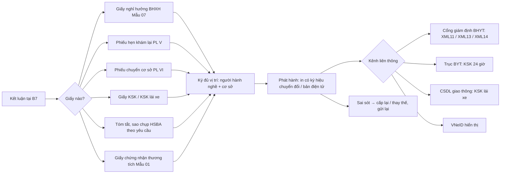

# Luồng tham chiếu: giấy tờ phát sinh từ lượt ngoại trú

> Kiểm tra lần cuối: 2026-10-27 · Áp dụng: phòng khám (dịch vụ hoặc BHYT), khoa khám bệnh BV; cơ sở đã công bố KSK · Luật liên quan: GIAYTO, BHYT-GD, BHYT-DATA, SKDT, EMR, DLCN, MA-LT · Nhãn: xem `../variation-points.md`

Luồng tham chiếu, không phải luồng của cơ sở nào. Điểm nối với `ngoai-tru.md`: giấy tờ sinh ra ở B7 (kết luận) và được đẩy đi khi kết thúc lượt ở B8. Giấy tờ của nội trú (giấy ra viện, báo tử, chứng sinh của khoa sản) để đợt sau; ở đây chỉ nhắc khi phòng khám sản có thể gặp.

Mọi giấy tờ ở đây đi theo **một vòng đời chung**: yêu cầu → soạn từ dữ liệu lượt → ký đủ vị trí → phát hành → gửi liên thông đúng kênh, đúng hạn → cấp lại/thay thế nếu sai. Phần `[THÔNG LỆ]` lấy từ kinh nghiệm triển khai; không có hướng dẫn ngành nào mô tả quy trình cấp giấy ở phòng khám.

## Sơ đồ tham chiếu

## Các bước chung

### G0 — Ai được ký, mẫu nào, ngày nào
- **Vai**: quản trị cơ sở; người phụ trách chuyên môn.
- **Đầu vào → ra**: danh sách người hành nghề, chứng thư số, văn bản phân công → ma trận người ký theo loại giấy; danh sách đã đăng ký với BHXH.
- `[LUẬT]`:
  - Mỗi mẫu có vị trí ký riêng (đại diện đơn vị + người hành nghề; người đứng đầu đồng thời là người khám thì chỉ ký một chỗ ở Mẫu 07); bản điện tử phiếu hẹn/phiếu chuyển thay dấu bằng ký số cơ sở từ 01/06/2026 (`GIAYTO-R04`, `MA-LT-R08`). Không suy rộng mốc 01/06/2026 cho giấy nghỉ việc, KSK.
  - Chọn mẫu theo **ngày sự kiện**, không theo ngày in; giấy đã cấp giữ nguyên mẫu cũ (`GIAYTO-R01`). Trường tối thiểu bắt buộc, được thêm trường, không tẩy xóa, tiếng Việt (`GIAYTO-R02`).
  - Người ký giấy chứng nhận phải nằm trong danh sách mẫu dấu, mẫu chữ ký đã đăng ký với BHXH; không đăng ký: phạt (`GIAYTO-R21`); chứng thư ký số đăng ký trên Cổng (`BHYT-DATA-R07`).
  - Bản điện tử ký số đầy đủ hiển thị trên VNeID tương đương bản giấy (`GIAYTO-R03`, `BẮT BUỘC?` với giấy ngoài diện liên thông bắt buộc).
  - Cơ sở phải có quy trình cấp giấy, giám sát người ghi, chịu trách nhiệm tính chính xác (`GIAYTO-R07`).
- `[THÔNG LỆ]`: PK tư: một bác sĩ phụ trách chuyên môn ký hầu hết giấy, kể cả khi không khám — vi phạm vị trí ký "người hành nghề KB, CB". BV: phòng KHTH giữ danh sách ký.
- `[HỎI]`: VP-GT-01 (ai được ký giấy nghỉ), VP-DM-04 (danh sách người hành nghề, bác sĩ thỉnh giảng). Thêm: đã đăng ký mẫu chữ ký với BHXH chưa, danh sách có khớp người đang khám không? Ai giữ chứng thư số tổ chức?
- **Dấu hiệu lệch chuẩn**: người ký ≠ người khám; giấy ký bởi người không trong danh sách BHXH; in giấy theo mẫu hiện tại cho sự kiện cũ.

### G1 — Soạn giấy từ dữ liệu lượt
- **Vai**: bác sĩ; điều dưỡng; bộ phận giấy tờ (BV).
- **Đầu vào → ra**: dữ liệu lượt (định danh, chẩn đoán ICD, ngày khám, người khám) → bản nháp giấy đúng mẫu, đủ trường bắt buộc.
- `[LUẬT]`: định danh người được cấp giấy: số định danh, hoặc hộ chiếu, CMND, giấy khai sinh; trẻ dưới 7 tuổi (giấy nghỉ việc) bắt buộc cha/mẹ/người giám hộ; mã số BHXH thay số thẻ chỉ khi BHXH thông báo (`GIAYTO-R22`); chẩn đoán kèm ICD-10 (`MA-LT-R01`); không viết tắt trong giấy cấp cho người bệnh (`EMR-R04`).
- `[THÔNG LỆ]`: giấy soạn từ template Word ngoài phần mềm rồi gõ lại; số giấy ghi tay trong sổ.
- `[HỎI]`: giấy nào đang in từ phần mềm, giấy nào làm tay? Số giấy/số seri cấp từ đâu?
- **Dấu hiệu lệch chuẩn**: nhập lại tên, ngày sinh bằng tay (lệch với hồ sơ); chẩn đoán trên giấy khác chẩn đoán trong hồ sơ; giấy không có số.

### G2 — Ký, phát hành
- **Vai**: người hành nghề; đại diện đơn vị; hệ thống ký số.
- **Đầu vào → ra**: bản nháp → bản đã ký đủ vị trí; bản in có ký hiệu chuyển đổi hoặc bản điện tử; bản có cấu trúc để liên thông.
- `[LUẬT]`: chặn phát hành khi còn vị trí ký bắt buộc (`GIAYTO-R04`); ký số hợp pháp, kiểm tra hiệu lực chứng thư (`EMR-R06`, `EMR-R07`); bản in có footer chuyển đổi từ hồ sơ điện tử, mã tra cứu, người in (`EMR-R13`); bản đã ký bất biến, lưu mọi lần gửi (`GIAYTO-R07`, `EMR-R10`).
- `[THÔNG LỆ]`: ký tay rồi scan, hoặc ký số theo lô cuối ngày; dấu đỏ vẫn đóng song song dù đã ký số.
- `[HỎI]`: VP-KH-08 (phương thức ký). Thêm: người bệnh có cần bản giấy có dấu đỏ không (nơi nhận giấy có chấp nhận bản điện tử)?
- **Dấu hiệu lệch chuẩn**: ảnh chữ ký/dấu dán vào PDF; phát hành rồi mới ký; giấy in không có ký hiệu chuyển đổi.

### G3 — Gửi liên thông theo kênh, đúng hạn
- **Vai**: hệ thống; nhân viên theo dõi liên thông.
- **Đầu vào → ra**: giấy đã ký → gói dữ liệu ký số lên đúng kênh; mã giao dịch, thời điểm tiếp nhận; trạng thái lỗi/quá hạn.
- `[LUẬT]` theo kênh:
  - **Cổng giám định BHYT** (QĐ 69/2025): giấy nghỉ việc hưởng BHXH, giấy chuyển, phiếu hẹn, tóm tắt HSBA… đẩy ngay khi kết thúc lượt; giấy nghỉ việc ngoại trú đẩy khi phát hành (`GIAYTO-R13`; BẮT BUỘC với cơ sở BHYT, `BẮT BUỘC?` với người bệnh không BHYT); bộ bảng chứng từ BHXH trong XML (`BHYT-DATA-R26`).
  - **Trục dữ liệu BYT**: dữ liệu KSK ký số trong 24 giờ sau kết thúc đợt khám (`SKDT-R15`, `GIAYTO-R19`).
  - **CSDL trật tự an toàn giao thông**: KSK lái xe (`GIAYTO-R20`; kết nối BẮT BUỘC, hạn 4 giờ `BẮT BUỘC?`).
  - Không kết nối, không tạo chứng từ điện tử: phạt theo NĐ 90/2026 Đ95 k4 b (`GIAYTO-R21`).
  - Bảng điều khiển đa kênh, đối soát với biên nhận, cảnh báo trước hạn (`GIAYTO-R23`, NÊN).
- `[THÔNG LỆ]`: gửi XML11 gom cùng XML lượt cuối ngày; KSK đoàn nhập tay trên `csdlksk.vn` sau khi khám xong cả đợt.
- `[HỎI]`: hiện giấy nào đang được gửi điện tử, kênh nào? Ai xem hồ sơ lỗi? KSK đoàn: "kết thúc đợt khám" tính theo từng người hay cả đoàn?
- **Dấu hiệu lệch chuẩn**: không biết giấy đã gửi hay chưa; không lưu mã giao dịch; giấy nghỉ việc chỉ in, không đẩy XML11.

### G4 — Sai sót, cấp lại, thay thế
- **Vai**: người ký; bộ phận giấy tờ; hệ thống.
- **Đầu vào → ra**: giấy đã phát hành có sai / mất / hỏng → phiên bản thay thế có lý do, cờ "Cấp lại", liên kết bản cũ; gửi lại dữ liệu lên kênh; bản cũ chuyển bị thay thế, không xóa.
- `[LUẬT]`: cấp lại khi mất, hỏng, sai thẩm quyền ký, sai dấu; sai thông tin thì bổ sung, sửa rồi đóng dấu treo; ngày ký giấy cấp lại là ngày phát hành (`GIAYTO-R06`; cách xử lý tương đương với dữ liệu đã liên thông là `BẮT BUỘC?`); dữ liệu BHYT đã gửi thì gửi lại có lý do, giữ phiên bản (`BHYT-DATA-R06`); giấy hẹn trả giấy và cấp đúng hẹn, kể cả cấp muộn theo văn bản đề nghị (`GIAYTO-R05`).
- `[THÔNG LỆ]`: sửa trực tiếp rồi in lại, số giấy giữ nguyên, không ai biết có bản cũ.
- `[HỎI]`: tần suất cấp lại? Ai duyệt? Người bệnh đã nộp giấy sai cho cơ quan BHXH thì cơ sở làm gì?
- **Dấu hiệu lệch chuẩn**: nút sửa giấy đã phát hành không sinh phiên bản; không có cờ cấp lại trên bản in.

## Từng loại giấy

### Giấy chứng nhận nghỉ việc hưởng BHXH (Mẫu 07 TT 25/2025)
- `[LUẬT]` `GIAYTO-R12`: chỉ ngoại trú; tối đa 30 ngày/lần (50 ngày cho sảy, phá thai, thai chết, thai ngoài tử cung từ 13 tuần; 180 ngày lao theo chương trình quốc gia); ngày bắt đầu nghỉ trùng ngày khám; ngày cấp trùng ngày khám (đợt nhiều ngày: ngày cuối); ICD-10 + tên bệnh, bệnh dài ngày theo PL I; trẻ dưới 7 tuổi ghi cha/mẹ; số KCB + số seri duy nhất; ký theo ma trận `GIAYTO-R04`; XML11 (`GIAYTO-R13`). Người ký phải trong danh sách đăng ký BHXH (`GIAYTO-R21`).
- `[THÔNG LỆ]`: bác sĩ cho nghỉ theo yêu cầu người bệnh ("xin thêm 2 ngày"); PK tư cấp cho người khám dịch vụ — vẫn hợp lệ nếu đủ điều kiện, nhưng Cổng nhận hồ sơ không thẻ thế nào chưa xác minh.
- `[HỎI]` VP-GT-01: ai được ký; có cấp cho người không BHYT không; có cấp lại khi sai không; người bệnh có đòi bản giấy không.
- **Dấu hiệu lệch chuẩn**: nghỉ > 30 ngày không có cờ lý do; ngày bắt đầu ≠ ngày khám; cấp cho lượt nội trú; người ký không khám.

### Phiếu hẹn khám lại (PL V TT 01/2025)
- `[LUẬT]` `BHYT-GD-R12`, `GIAYTO-R17`: ghi trên phiếu riêng hoặc trong đơn thuốc; mỗi phiếu dùng một lần; chỉ hẹn một lần sau khi kết thúc một đợt; bản điện tử: chữ ký số bác sĩ + ký số cơ sở từ 01/06/2026 (`MA-LT-R08`); XML14. Phiếu phát hành trước 01/06/2026 chỉ có chữ ký bác sĩ vẫn hợp lệ (suy luận trong domain).
- `[THÔNG LỆ]`: hẹn ghi trong đơn thuốc thay phiếu riêng; PK tư hẹn qua Zalo/điện thoại không phát hành phiếu.
- `[HỎI]` VP-GT-02: hẹn ghi ở đâu; người bệnh đến trước/sau ngày hẹn xử lý sao; hẹn ở đơn thuốc có được quản lý "đã dùng" không.
- **Dấu hiệu lệch chuẩn**: in lại phiếu hẹn nhiều lần; hẹn lần hai cho cùng đợt đã kết thúc; phiếu điện tử chỉ có một chữ ký sau 01/06/2026.

### Phiếu chuyển cơ sở KCB (PL VI TT 01/2025)
- `[LUẬT]` `BHYT-GD-R11`, `GIAYTO-R17`: giá trị 10 ngày làm việc từ ngày ký (bệnh PL III: 01 năm; hết hạn khi đang điều trị thì dùng đến hết đợt); hai chữ ký số từ 01/06/2026 (`MA-LT-R08`); tiếp nhận phiếu đến phải kiểm còn hạn; XML13 (`BHYT-DATA-R26`); hiển thị VNeID (`GIAYTO-R03`). Thuật ngữ đổi sang "chuyển cơ sở KCB", bảng XML vẫn tên "giấy chuyển tuyến".
- `[THÔNG LỆ]`: PK chuyển lên BV bằng "giấy giới thiệu" tự chế kèm kết quả; BV công chuyển theo đúng mẫu vì liên quan quyền lợi BHYT.
- `[HỎI]`: VP-GT-02. Thêm: chuyển đi đâu nhiều nhất; có nhận phiếu chuyển đến không (PK chuyên khoa nhận từ tuyến dưới).
- **Dấu hiệu lệch chuẩn**: giấy giới thiệu không theo PL VI dùng cho lượt BHYT; không tính hạn 10 ngày làm việc; không kiểm hạn phiếu đến.

### Giấy khám sức khỏe (TT 32/2023 Chương VI, mẫu TT 25/2026) và KSK lái xe (TT 36/2024)
- `[LUẬT]` `GIAYTO-R18`: mẫu theo tuổi và mục đích (01 dưới 6, 02 từ 6 đến dưới 18, 03 từ 18, 04 tâm thần); bác sĩ KSK phải được phân công bằng văn bản, có GPHN; KSK định kỳ chỉ làm CLS khi có chỉ định; KSK theo yêu cầu thiếu chuyên khoa thì không phân loại; ảnh không quá 6 tháng; trả trong 24 giờ; giá trị 12 tháng; lưu tối thiểu 02 năm. Liên thông: 17 mẫu QĐ 1551, ký số từng bác sĩ chuyên khoa + người kết luận + cơ sở, gửi Trục BYT trong 24 giờ sau kết thúc đợt khám (`SKDT-R15`, `GIAYTO-R19`). Lái xe: mẫu PL II TT 36, xét nghiệm ma túy cho nhóm tương ứng, kết nối CSDL giao thông (`GIAYTO-R20`; hạn 4 giờ `BẮT BUỘC?`). Chế tài cấp giấy khi không khám đủ nội dung, KSK khi chưa công bố (`GIAYTO-R21`). Khám chứng thương không thuộc KSK (`GIAYTO-R16`).
- `[THÔNG LỆ]`: KSK đoàn (doanh nghiệp, trường học) khám tại chỗ theo bàn, nhập kết quả sau; giấy KSK đi làm "ký nhanh" thiếu chuyên khoa; PK tính một phiếu KSK là một lượt khám dịch vụ.
- `[HỎI]` VP-GT-03: có KSK không, loại nào (đi làm, đi học, lái xe, định kỳ doanh nghiệp, đoàn)? Khám đoàn ngoài cơ sở có không? Đã công bố đủ điều kiện KSK chưa? "Kết thúc đợt khám" với đoàn tính thế nào?
- **Dấu hiệu lệch chuẩn**: người ký kết luận không trong danh sách phân công; phân loại khi thiếu chuyên khoa; không gửi Trục BYT trong 24 giờ; cùng số 25 nhầm TT 25/2025 (BHXH) với TT 25/2026 (KSK).

### Tóm tắt HSBA (Mẫu 03), sao chụp hồ sơ theo yêu cầu
- `[LUẬT]` `EMR-R14`, `GIAYTO-R15`, `DLCN-R06`: yêu cầu bằng văn bản (Mẫu 04, giấy hoặc điện tử); kiểm tra tư cách: người bệnh và đại diện theo Luật KCB Đ8 k2 c, d được đọc, sao chụp, nhận tóm tắt; đại diện theo Đ8 k2 a, d chỉ được tóm tắt; trả giấy hẹn và cấp đúng hẹn (`GIAYTO-R05`); tóm tắt ký số cơ sở, bản in có ký hiệu chuyển đổi (`EMR-R13`); ghi vết lần cung cấp; XML8/XML10 khi thuộc diện QĐ 69 (`GIAYTO-R13`). Từ chối cung cấp cho chính chủ thể bị phạt (`DLCN-R06`).
- `[THÔNG LỆ]`: PK in "giấy xác nhận đã khám" tự thiết kế thay tóm tắt Mẫu 03; người nhà xin hồ sơ qua điện thoại được gửi luôn.
- `[HỎI]` VP-GT-05: ai tiếp nhận yêu cầu, có mẫu đề nghị không, mất bao lâu, có thu phí sao chụp không, người nhà xin hồ sơ xử lý sao.
- **Dấu hiệu lệch chuẩn**: cấp tóm tắt không có văn bản đề nghị; app cho người nhà xem toàn bộ hồ sơ; dùng mẫu tự chế cho mục đích pháp lý (bảo hiểm, tòa án).

### Giấy chứng nhận thương tích (Mẫu 01 TT 25/2025)
- `[LUẬT]` `GIAYTO-R16`: hồ sơ phải có mô tả tổn thương lúc vào và lúc ra; ký đại diện đơn vị + người hành nghề; giấy hẹn (`GIAYTO-R05`); cấp lại theo `GIAYTO-R06`; không có bảng XML riêng, không thấy nghĩa vụ liên thông điện tử.
- `[THÔNG LỆ]`: ít gặp ở PK; thường ở BV cấp cứu/chấn thương chỉnh hình; hay bị xin cấp sau nhiều tháng cho mục đích pháp lý.
- `[HỎI]`: có cấp loại này không; yêu cầu đến từ ai (công an, tòa, bảo hiểm) và tiếp nhận qua đâu.
- **Dấu hiệu lệch chuẩn**: bệnh án không có mô tả tổn thương lúc ra nhưng vẫn cấp giấy.

### (Chỉ nếu PK sản) Giấy chứng sinh
Thuộc đợt nội trú/sản. Nhắc để không sót: liên thông trong 04 giờ làm việc, định danh người mẹ, cấp lại giữ nguyên mã số (`GIAYTO-R08`, `GIAYTO-R22`, `GIAYTO-R06`). Không phân tích ở đây.

## Biến thể theo loại cơ sở

| Khía cạnh | PK thuần dịch vụ | PK có hợp đồng BHYT | Khoa khám bệnh BV | Chuỗi PK |
|---|---|---|---|---|
| Giấy nghỉ hưởng BHXH | Được cấp nếu đủ điều kiện `[LUẬT]`; Cổng nhận hồ sơ không thẻ: chưa xác minh | Có, XML11 `[LUẬT]` | Có, XML11 `[LUẬT]` | Theo từng cơ sở (mã riêng) `[LUẬT]` |
| Phiếu hẹn / phiếu chuyển PL V, VI | Không bắt buộc theo mẫu BHYT; hay dùng giấy giới thiệu `[THÔNG LỆ]` | Theo mẫu, hai chữ ký số, XML13/14 `[LUẬT]` | Như PK-BHYT `[LUẬT]` | Chuyển giữa chi nhánh vẫn là chuyển cơ sở `[LUẬT]` |
| KSK | Phổ biến nếu đã công bố `[HỎI]` | Có `[HỎI]` | Có, khoa KSK riêng `[THÔNG LỆ]` | Khám đoàn lưu động nhiều `[HỎI]` |
| Danh sách người ký đăng ký BHXH | Chỉ cần nếu cấp giấy BHXH `[LUẬT]` | Bắt buộc `[LUẬT]` | Bắt buộc `[LUẬT]` | Mỗi cơ sở một danh sách `[LUẬT]` |
| Tóm tắt HSBA | Hay thay bằng giấy xác nhận tự chế `[THÔNG LỆ]` | Mẫu 03 `[LUẬT]` | Mẫu 03, phòng KHTH xử lý `[THÔNG LỆ]` | Ai cấp khi khám nhiều chi nhánh `[HỎI]` |
| Theo dõi hạn liên thông | Ít kênh | Cổng giám định + Trục BYT | Nhiều kênh, cần bảng điều khiển (`GIAYTO-R23`, NÊN) | Tập trung hay theo chi nhánh `[HỎI]` |

## Điểm biến thiên của luồng này
VP-GT-01 → VP-GT-06; liên quan: VP-KH-08 (phương thức ký), VP-DM-04 (danh sách người hành nghề), VP-DM-06 (chuỗi, mã cơ sở) trong `../variation-points.md`.

## Dữ liệu và giấy tờ sinh ra
Ma trận người ký theo mẫu · danh sách người ký đã đăng ký BHXH · yêu cầu cấp giấy và giấy hẹn trả · giấy nghỉ hưởng BHXH (số KCB, số seri) · phiếu hẹn (ID, đã dùng) · phiếu chuyển (hạn 10 ngày làm việc/01 năm) · giấy KSK theo mẫu tuổi/mục đích, sổ KSK lái xe · giấy đề nghị Mẫu 04, tóm tắt Mẫu 03 · giấy chứng nhận thương tích · bản đã ký (cá nhân + tổ chức), bản in có ký hiệu chuyển đổi · gói XML11/13/14, gói KSK 17 mẫu, gói KSK lái xe · biên nhận theo kênh · phiên bản cấp lại/thay thế · nhật ký cung cấp hồ sơ (`EMR-R12`).

## Câu hỏi mở của chính luồng tham chiếu (chưa xác minh)
- Cổng giám định nhận chứng từ của người bệnh không có thẻ BHYT thế nào (`GIAYTO-R13`).
- Ký số tổ chức thay dấu cho giấy ngoài phiếu hẹn/phiếu chuyển: chỉ có căn cứ chung Luật GDĐT (`GIAYTO-R04`).
- Cơ chế thu hồi dữ liệu giấy đã gửi lên Cổng khi cấp lại (`GIAYTO-R06`).
- "Kết thúc đợt khám" KSK tính theo từng người hay cả đoàn; KSK đi học, đi làm có phải gửi Trục BYT không (`SKDT-R15`).
- Kênh kỹ thuật và hạn 4 giờ cho KSK lái xe sau Luật TTATGTĐB 2024 (`GIAYTO-R20`).
- Mẫu 01–04 KSK mới của TT 25/2026 chưa lấy được phụ lục (`GIAYTO-R18`).
