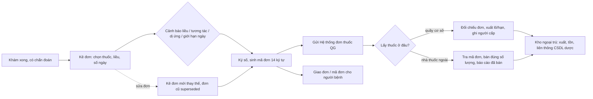

# Luồng tham chiếu: kê đơn ngoại trú → cấp phát / bán thuốc theo đơn

> Kiểm tra lần cuối: 2026-10-27 · Áp dụng: phòng khám (dịch vụ hoặc BHYT), khoa khám bệnh bệnh viện, quầy cấp phát/nhà thuốc trong cơ sở, nhà thuốc ngoài nhận đơn điện tử · Luật liên quan: DUOC, EMR, BHYT-DATA, CHUYENKHOA (YHCT), DLCN · Nhãn: xem `../variation-points.md`

Đây là nhánh B6 của `ngoai-tru.md`. Luồng gồm hai nửa tách rời về pháp lý: **kê đơn** (nghĩa vụ của cơ sở KCB và người kê) và **cấp phát/bán** (nghĩa vụ của quầy cấp phát hoặc nhà thuốc). Nhiều phòng khám gộp hai nửa vào một người, một màn hình; luật vẫn tách. Nội trú (y lệnh thuốc, eMAR, tổng hợp thuốc nội trú) chưa làm trong đợt này.

## Sơ đồ tham chiếu

Thu tiền thuốc (nếu cấp phát tại cơ sở) không vẽ ở đây: vị trí của nó là điểm biến thiên VP-TD-08 / VP-CLS-02 và xử lý trong `vien-phi-bhyt.md`.

## Các bước

### B1 — Kê đơn
- **Vai**: bác sĩ/y sĩ có thẩm quyền; điều dưỡng/thư ký (nhập hộ, không được ký).
- **Đầu vào → ra**: chẩn đoán ICD trong phiếu khám/HSBA, tiền sử dị ứng, lịch sử thuốc → đơn nháp.
- `[LUẬT]`:
  - Chỉ người có CCHN/GPHN đúng phạm vi mới được kê; thuốc YHCT theo ma trận chức danh × loại thuốc (`DUOC-R01`). Mỗi cơ sở và mỗi người kê một mã liên thông duy nhất (`DUOC-R02`).
  - Đủ trường theo mẫu PL I/II/III TT 26; trẻ dưới 72 tháng phải có tháng tuổi, cân nặng, người đưa trẻ; không kê thực phẩm chức năng vào đơn thuốc; khám nhiều chuyên khoa một lần vẫn 01 đơn (`DUOC-R03`).
  - Cách ghi thuốc: INN/tên thương mại theo số hoạt chất, liều, đường dùng, thời điểm, số ngày; thuốc độc ghi trước; số lượng < 10 có số 0 phía trước; đơn phải bằng tiếng Việt (`DUOC-R05`).
  - Giới hạn số ngày: ≤ 30 ngày; bệnh trong PL VII TT 26 ≤ 90 ngày; gây nghiện cấp tính ≤ 7 ngày; hướng thần/tiền chất ≤ 10/30 ngày; ung thư 3 đợt mỗi đợt ≤ 10 ngày (`DUOC-R06`).
  - Đơn phải khớp chỉ định trong HSBA khi có HSBA ngoại trú (`DUOC-R10`, `EMR-R28`).
  - Danh mục thuốc nội bộ phải có cờ gây nghiện/hướng thần/tiền chất/độc/dược liệu độc/hạn chế bán lẻ/OTC để điều khiển loại đơn và giới hạn (`DUOC-R32`); gợi ý cờ từ số đăng ký 12 chữ số (`DUOC-R31`, NÊN).
  - Lượt BHYT: thuốc kê phải nằm trong danh mục sử dụng tại cơ sở đã được Cổng chấp nhận tại ngày y lệnh, có mã hoạt chất và thông tin thầu (`BHYT-DATA-R18`, `BHYT-DATA-R19`).
- `[THÔNG LỆ]`: bác sĩ dùng "đơn mẫu"/phác đồ cá nhân để kê nhanh; PK tư kê tên thương mại theo thuốc đang có trong kho; BV kê theo danh mục thầu. Lịch tái khám viết trong lời dặn của đơn.
- `[HỎI]`: VP-DT-07 (có danh sách dị ứng theo người bệnh? chặn hay chỉ cảnh báo?), VP-DM-02 (có thầu? thuốc ngoài thầu xử lý sao?). Thêm: bác sĩ có kê thuốc ngoài kho cho người bệnh mua ngoài không, tỷ lệ bao nhiêu? Có kê đơn mẫu theo bác sĩ không?
- **Dấu hiệu lệch chuẩn**: đơn có thực phẩm chức năng, mỹ phẩm; số ngày vượt giới hạn mà phần mềm không chặn; điều dưỡng kê rồi bác sĩ "ký sau" bằng tài khoản mượn; tên thuốc tự gõ không gắn danh mục.

### B2 — Cảnh báo lâm sàng
- **Vai**: hệ thống; bác sĩ quyết định.
- `[LUẬT]`: nghĩa vụ kê phù hợp tờ hướng dẫn sử dụng, hướng dẫn chẩn đoán điều trị, Dược thư là của người kê; phần mềm cảnh báo liều, tương tác, chống chỉ định là `NÊN`; trẻ dưới 72 tháng tính liều theo cân nặng (`DUOC-R34`). Thuốc YHCT: chỉ định phải phù hợp tờ hướng dẫn hoặc hướng dẫn BYT thì BHYT mới trả (`CHUYENKHOA-R07`).
- `[THÔNG LỆ]`: PK tư hầu như không có cảnh báo tương tác; BV lớn có CDSS nhưng bác sĩ hay tắt vì quá nhiều cảnh báo.
- `[HỎI]`: VP-DT-07. Mức chặn cứng nào cơ sở chấp nhận (ví dụ: dị ứng đã ghi nhận thì chặn, tương tác chỉ cảnh báo)?

### B3 — Thuốc gây nghiện, hướng thần, tiền chất ("N", "H")
- **Vai**: bác sĩ có chữ ký mẫu đã đăng ký; dược sĩ.
- `[LUẬT]`: đơn N, H là đơn riêng, 03 bản; đơn N chỉ ở cơ sở **có giường bệnh** (`DUOC-R07`). Kê N phải kèm cam kết PL IV; ung thư phải lập HSBA ngoại trú; xác nhận trạm y tế PL V dùng cho đúng một đơn; quản lý chữ ký mẫu người kê (`DUOC-R08`). Nhận lại thuốc không dùng hết có biên bản PL VI, biệt trữ (`DUOC-R18`). Báo cáo KSĐB trước 15/01 hằng năm; thất thoát báo trong 48 giờ (`DUOC-R19`).
- `[THÔNG LỆ]`: PK không giường gần như không kê N; vẫn có thể kê H (an thần) ở PK chuyên khoa tâm thần, thần kinh.
- `[HỎI]`: VP-DT-03 (cơ sở có kê N/H không; loại hình có giường không?). Ai giữ chữ ký mẫu, ai lập báo cáo KSĐB?
- **Dấu hiệu lệch chuẩn**: PK không giường mà phần mềm cho tạo đơn N; đơn H in chung mẫu với đơn thường; không có biên bản nhận lại thuốc.

### B4 — Ký số, sinh mã đơn, phát hành
- **Vai**: người kê (chữ ký số cá nhân) hoặc người chịu trách nhiệm chuyên môn (ký số) + người kê (chữ ký điện tử) theo một trong hai mô hình QĐ 425.
- **Đầu vào → ra**: đơn nháp → đơn đã phát hành (bất biến), mã đơn 14 ký tự, bản in/PDF.
- `[LUẬT]`: mã đơn `xxxxx` (mã cơ sở) + `yyyyyyy` (ngẫu nhiên, duy nhất trong cơ sở) + `-` + `z` (N/H/C/T), 14 ký tự, bất biến (`DUOC-R04`). Kê đơn điện tử và ký số đã quá hạn với mọi loại cơ sở (BV 01/10/2025, cơ sở khác 01/01/2026) (`DUOC-R11`, `EMR-R28`). Đơn đã gửi không được sửa: sửa = kê đơn mới thay thế, đơn cũ không còn dùng để cấp/bán (`DUOC-R09`). Đơn hết hiệu lực lĩnh thuốc sau 05 ngày kể từ ngày kê (`DUOC-R16`). Thời hạn lưu đơn và tài liệu kèm, trích xuất được khi cần (`DUOC-R15`).
- `[THÔNG LỆ]`: bác sĩ ký theo lô cuối buổi; PK tư in đơn có chữ ký tay rồi lưu scan — không còn hợp lệ. PK tư YHCT có cơ chế lai "nhập máy, in, ký tay" theo TT 55 Đ10 k2 (`DUOC-R11` bẫy) — chỉ cho YHCT.
- `[HỎI]`: VP-KH-08 (bác sĩ có chứng thư số chưa? token hay ký từ xa? chấp nhận ký theo lô không?), VP-DT-02 (hiện sửa đơn kiểu gì, tần suất?).
- **Dấu hiệu lệch chuẩn**: mã đơn tăng dần; mã đơn đổi khi in lại; nút "sửa đơn" sau khi đã ký; ảnh chữ ký dán vào PDF.

### B5 — Gửi Hệ thống đơn thuốc quốc gia và giao đơn cho người bệnh
- **Vai**: hệ thống; bộ phận CNTT theo dõi lỗi.
- `[LUẬT]`: gửi đơn ngoại trú "ngay sau khi kết thúc quy trình khám bệnh, chữa bệnh"; hàng đợi gửi lại khi lỗi, lưu mã phản hồi (`DUOC-R12`). Kết nối theo chuẩn BYT, giữ phiên bản đặc tả (`DUOC-R13`, `BẮT BUỘC?`). Vendor **không được cấp tài khoản** trên Hệ thống đơn thuốc QG; tài khoản là của cơ sở (`DUOC-R02` bẫy). Gửi đơn hoặc mã đơn cho người bệnh qua phương tiện điện tử, lưu bằng chứng (`DUOC-R14`). Đơn HIV/AIDS mã hóa thông tin người bệnh; mã hóa trường định danh (`DUOC-R21`, `BẮT BUỘC?`). Đơn YHCT ngoại trú cũng phải gửi dù lộ trình e-Rx YHCT chưa có ngày (`DUOC-R17`).
- `[THÔNG LỆ]`: nhiều cơ sở gửi theo job cuối ngày; không ai xem màn hình đơn lỗi; mã đơn in dạng QR trên toa.
- `[HỎI]`: VP-DT-01 (gửi ngay hay gom? ai theo dõi đơn lỗi?), VP-DT-08 (gửi mã đơn cho người bệnh qua kênh nào?). Tài khoản Hệ thống đơn thuốc QG hiện ai giữ?
- **Dấu hiệu lệch chuẩn**: job gửi cuối ngày/cuối tuần; vendor giữ tài khoản quản trị của cơ sở; không lưu phản hồi; tin nhắn gửi người bệnh chứa chẩn đoán dạng rõ.

### B6a — Cấp phát tại quầy của cơ sở KCB
- **Vai**: dược sĩ/nhân viên cấp phát; thu ngân (nếu thu tiền thuốc).
- **Đầu vào → ra**: đơn đã phát hành (quét mã) → phiếu xuất theo lô/hạn, ghi người cấp và thời gian; tồn kho giảm.
- `[LUẬT]`: đối chiếu đơn với thuốc, hàm lượng, hạn dùng, số lượng, họ tên người bệnh; chặn lô hết hạn hoặc bị thu hồi; ghi người cấp, thời gian cấp (`DUOC-R20`). Thuốc N/H: bản có dấu lưu nơi cấp, người nhận xuất trình căn cước (`DUOC-R07`). Lượt BHYT: dòng thuốc trong XML2 mang mã hoạt chất, số đăng ký, thông tin thầu đúng cú pháp (`BHYT-DATA-R18`).
- `[THÔNG LỆ]`: PK tư: lễ tân kiêm phát thuốc, soạn thuốc theo toa in giấy; không quét lô. BV: quầy cấp phát BHYT tách quầy nhà thuốc dịch vụ.
- `[HỎI]`: VP-DT-04 (có quầy không? của cơ sở hay thuê? người phát thuốc là ai?), VP-DT-06 (quản kho bằng gì? nhập lô/hạn từng phiếu không?). Thêm: cấp một phần đơn (hết hàng) thì xử lý sao — phần còn lại người bệnh mua ngoài hay chờ?
- **Dấu hiệu lệch chuẩn**: xuất kho theo tổng số không theo lô; người cấp không đăng nhập riêng; cấp thuốc cho đơn đã bị thay thế; cấp thuốc trước khi đơn được ký.

### B6b — Mua tại nhà thuốc ngoài theo đơn điện tử
- **Vai**: dược sĩ nhà thuốc; phần mềm bán lẻ.
- `[LUẬT]` (áp cho nhà thuốc, nêu ở đây để BA biết phía nhận đơn cần gì): chỉ bán thuốc kê đơn khi có đơn, thuốc gây nghiện chỉ theo đơn N (`DUOC-R22`); tra mã đơn, bán không vượt số lượng kê, không bán đơn hết hạn, báo cáo đơn đã bán ngay sau khi bán (`DUOC-R23`); thay thế thuốc cùng hoạt chất/đường dùng/liều chỉ bởi người có bằng dược sĩ và khi người mua đồng ý (`DUOC-R24`); thuốc hạn chế bán lẻ theo chỉ định trên đơn (`DUOC-R28`); lưu đơn tại thời điểm bán (`DUOC-R27`).
- `[THÔNG LỆ]`: nhà thuốc nhỏ tra đơn bằng app/web của BYT rồi nhập tay vào phần mềm bán hàng; mã đơn in trên toa giấy là thứ người bệnh đưa.
- `[HỎI]`: VP-DT-05 (nếu cơ sở có nhà thuốc riêng: dược sĩ có đổi thuốc không, ghi ở đâu?). Nhà thuốc trong cơ sở có bán cho người ngoài không? Là pháp nhân nào (ảnh hưởng hóa đơn máy tính tiền, `vien-phi-bhyt.md`)?
- **Dấu hiệu lệch chuẩn**: bán thuốc kê đơn không gắn mã đơn; bán vượt số lượng; không báo cáo đã bán.

### B7 — Kho thuốc ngoại trú và liên thông CSDL dược
- **Vai**: thủ kho/dược sĩ phụ trách; kế toán.
- `[LUẬT]`: quản lý mua bán bằng phần mềm: xuất nhập tồn, lô, hạn, nguồn gốc, truy xuất được, trích xuất đủ dữ liệu; niêm yết giá và không bán cao hơn giá niêm yết (`DUOC-R25`); liên thông Hệ thống CSDL về dược từ 01/01/2026, dữ liệu tính từ mốc này, tài khoản theo từng cơ sở (`DUOC-R26`); sổ theo dõi thuốc KSĐB riêng, khóa sửa xóa (`DUOC-R30`). Lưu hồ sơ, sổ sách ≥ 1 năm sau hết hạn dùng của thuốc (`DUOC-R27`).
- `[THÔNG LỆ]`: PK tư nhập kho theo hóa đơn nhà cung cấp cuối tuần, không theo lô; kiểm kê cuối tháng chênh thì "điều chỉnh". Nhầm lẫn phổ biến: CSDL dược (`csdlduoc`, TTYQG) khác Hệ thống đơn thuốc QG (`DUOC-R26` bẫy).
- `[HỎI]`: VP-DT-06. Thêm: ai nhập kho? có nhiều kho (kho chính, tủ trực, quầy)? kiểm kê bao lâu một lần? đã đăng ký tài khoản CSDL dược chưa (CV 3656/QLD-KD hạn 04/10/2026, thứ cấp)?
- **Dấu hiệu lệch chuẩn**: tồn âm; điều chỉnh tồn không lý do; không có lô/hạn; chưa đăng ký liên thông CSDL dược; một tài khoản liên thông dùng chung cho nhiều nhà thuốc trong chuỗi.

### B8 — Đơn YHCT (nếu cơ sở có)
- **Vai**: bác sĩ/y sĩ YHCT, lương y (phạm vi hẹp); phòng sắc thuốc.
- `[LUẬT]`: đơn thang theo mẫu TT 55: vị thuốc, khối lượng, số thang, cách sắc, cách uống; tên theo Dược điển, không viết tắt; vị từ dược liệu độc ghi số và chữ; vượt liều phải có "tôi kê liều này" (`DUOC-R03`, `DUOC-R05`); giới hạn ngày thang ≤ 30, có dược liệu độc ≤ 05 (`DUOC-R06`); z = T cho đơn thang; tách đơn kết hợp thành các đơn theo mẫu (`DUOC-R17`). BHYT: thuốc YHCT ghi tên theo thành phần, không tên thương mại; chế phẩm tự bào chế chỉ dùng tại chính cơ sở; thành phần ngoài danh mục không được thanh toán; sắc thuốc là dòng dịch vụ riêng (`CHUYENKHOA-R05`, `CHUYENKHOA-R06`).
- `[THÔNG LỆ]`: PK YHCT tư thường ghi bài thuốc theo tên riêng ("bài gia truyền"), không liệt kê vị — không hợp lệ cho đơn điện tử.
- `[HỎI]`: cơ sở có YHCT không; có sắc thuốc tại chỗ không; ai được kê kết hợp hóa dược (văn bản cho phép)?

## Biến thể theo loại cơ sở

| Khía cạnh | PK thuần dịch vụ | PK có hợp đồng BHYT | Khoa khám bệnh BV | Chuỗi PK / chuỗi nhà thuốc |
|---|---|---|---|---|
| Nguồn thuốc để kê | Kho nội bộ hoặc kê cho mua ngoài `[HỎI]` | Danh mục đã gửi Cổng, thầu `[LUẬT]` | Danh mục thầu `[LUẬT]` | Danh mục chuỗi, kho từng chi nhánh `[HỎI]` |
| Đơn N | Không (không giường) `[LUẬT]` | Không | Có, có giường | Không |
| Ký số | Bắt buộc, đã quá hạn `[LUẬT]` | Bắt buộc | Bắt buộc | Bắt buộc; chứng thư từng bác sĩ |
| Gửi đơn QG | Mọi lượt kê đơn `[LUẬT]` | Mọi lượt | Mọi lượt | Theo mã liên thông từng cơ sở (`DUOC-R02`) |
| Cấp phát | Thường lễ tân kiêm `[THÔNG LỆ]` | Quầy BHYT | Quầy cấp phát + nhà thuốc BV | Nhà thuốc chuỗi là pháp nhân riêng hay không `[HỎI]` |
| Liên thông CSDL dược | Nếu có bán lẻ `[LUẬT]` | Có | Nhà thuốc BV | Mỗi điểm một tài khoản `[LUẬT]` |
| Thanh toán thuốc | Thu cùng khám hoặc tại quầy `[HỎI]` | BHYT: trong bảng kê; dịch vụ: tại quầy | Trong bảng kê | Theo chính sách chuỗi |

## Điểm biến thiên của luồng này
VP-DT-01 → VP-DT-08, VP-DM-02, VP-KH-08 trong `../variation-points.md`.

## Dữ liệu và giấy tờ sinh ra
Đơn thuốc đã ký (mã 14 ký tự, PDF/bản chuẩn hóa, phiên bản thay thế) · cam kết PL IV, xác nhận PL V, biên bản PL VI (thuốc N) · phản hồi Hệ thống đơn thuốc QG · bằng chứng đã giao mã đơn cho người bệnh · phiếu xuất kho theo lô, người cấp, thời gian · sổ KSĐB · bút toán kho và trạng thái đồng bộ CSDL dược · báo cáo KSĐB năm, báo cáo đơn đã bán (nhà thuốc) · dòng XML2 (lượt BHYT) · nhật ký vòng đời đơn (`DUOC-R33`, NÊN).

## Câu hỏi mở của chính luồng tham chiếu (chưa xác minh)
- Đơn N/H điện tử: Đ7, Đ9 TT 26 vẫn đòi bản có dấu lưu nơi bán; chưa có hướng dẫn bỏ bản giấy (`DUOC-R07` bẫy).
- Đặc tả kết nối Hệ thống đơn thuốc QG theo TT 26 Đ12 k3 a chưa thấy bản mới; QĐ 808 mới đọc qua thứ cấp (`DUOC-R13`).
- Chi tiết API và yêu cầu "thời gian thực" của CSDL dược là nguồn thứ cấp (`DUOC-R26`).
- Thời hạn lưu đơn: Phụ lục TT 33/2025 không có dòng riêng cho đơn thuốc (`DUOC-R15`).
- Phần mềm có thay hoàn toàn sổ theo dõi thuốc N/H/tiền chất đơn chất không (`DUOC-R30` bẫy).
