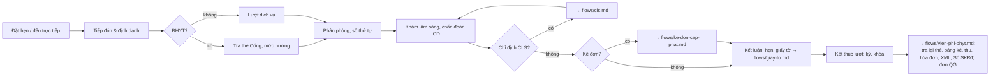

# Luồng tham chiếu: khám ngoại trú (tiếp đón → khám → kết thúc lượt)

> Kiểm tra lần cuối: 2026-10-27 · Áp dụng: phòng khám đa khoa/chuyên khoa (dịch vụ hoặc BHYT), khoa khám bệnh bệnh viện · Luật liên quan: EMR, SKDT, BHYT-GD, BHYT-DATA, MA-LT, DLCN, CHUYENKHOA, TC-MS · Nhãn: xem `../variation-points.md`

Đây là **luồng tham chiếu**, không phải luồng của bất kỳ cơ sở nào. Dùng nó để: (1) soạn câu hỏi trước khảo sát, (2) đặt cạnh luồng as-is của khách để thấy chỗ lệch, (3) biết bước nào bị luật khóa cứng. Các nhánh CLS, kê đơn–cấp phát, viện phí–BHYT, giấy tờ có file riêng cùng thư mục; file này chỉ nêu điểm nối.

Nguồn cho phần `[THÔNG LỆ]`: QĐ 1313/QĐ-BYT (22/04/2013) hướng dẫn quy trình khám bệnh tại khoa khám bệnh của bệnh viện — hướng dẫn, không phải VBQPPL, chỉ nói về bệnh viện, hiệu lực hiện nay chưa xác minh; cộng kinh nghiệm triển khai. Không có nguồn chính thống nào mô tả quy trình phòng khám tư.

## Sơ đồ tham chiếu

Bước thu tiền **không có vị trí cố định** trên sơ đồ: đó là điểm biến thiên lớn nhất giữa các cơ sở (VP-TD-08, VP-CLS-02). Xem mục "Biến thể theo loại cơ sở".

## Các bước

### B0 — Đặt hẹn (nếu có)
- **Vai**: người bệnh, lễ tân/CSKH, hệ thống đặt lịch.
- **Đầu vào → ra**: nhu cầu khám → lịch hẹn (người bệnh tạm, phòng/bác sĩ, khung giờ).
- `[LUẬT]`: dữ liệu đặt hẹn đã là dữ liệu cá nhân sức khỏe → căn cứ xử lý, thông báo (`DLCN-R02`, `R03`); tin nhắn nhắc hẹn/CSKH theo `DLCN-R28`. Nếu đặt qua app bên thứ ba: `TELE` domain.
- `[THÔNG LỆ]`: PK tư nhận hẹn qua điện thoại/Zalo/fanpage, ghi sổ hoặc Google Sheet; BV công đặt qua tổng đài/app nhưng phần lớn vẫn walk-in.
- `[HỎI]` VP-TD-03: kênh, tỷ lệ hẹn/walk-in, giữ chỗ, trễ hẹn, hủy, đặt cọc.
- **Dấu hiệu lệch chuẩn**: lịch hẹn nằm ngoài phần mềm → hồ sơ tạo hai lần, trùng.

### B1 — Tiếp đón và định danh
- **Vai**: nhân viên tiếp đón; người bệnh/người đại diện.
- **Đầu vào → ra**: giấy tờ hoặc VNeID → hồ sơ người bệnh (mới hoặc tìm được), lượt khám mở, đồng ý xử lý dữ liệu.
- `[LUẬT]`:
  - Tìm/tạo người bệnh bằng số định danh, căn cước (QR), số thẻ BHYT, kể cả người không BHYT (`SKDT-R04`, `SKDT-R05`, `EMR-R05`). Lưu nguồn định danh và nguồn xác thực theo lượt (`SKDT-R09`).
  - Người chưa có số định danh: trẻ em, người nước ngoài, vô danh (`SKDT-R10`–`R12`); mã tạm, gộp khi có số thật (`SKDT-R13`, `R14`).
  - Chấp nhận mọi hình thức xuất trình thẻ BHYT, không đòi thẻ giấy, không đặt thêm thủ tục, sao chụp phải có đồng ý (`BHYT-GD-R01`, `R04`); trẻ dưới 6 tuổi, người hiến (`BHYT-GD-R05`).
  - Đồng ý xử lý dữ liệu cá nhân: hình thức, bằng chứng, không mặc định tích sẵn; trẻ em/người đại diện (`DLCN-R03`, `R08`).
  - Ưu tiên 7 nhóm (`CHUYENKHOA-R39`); nhu cầu ngôn ngữ/phiên dịch (`CHUYENKHOA-R35`).
- `[THÔNG LỆ]`: BV: một quầy tiếp đón chung, cấp số, in phiếu khám; PK tư: lễ tân kiêm thu ngân, tạo hồ sơ rồi dẫn vào phòng luôn. Người tái khám thường được tìm theo SĐT (rủi ro trùng hồ sơ).
- `[HỎI]`: VP-TD-02 (ai gộp hồ sơ), VP-TD-04 (số thứ tự), VP-TD-05 (cách ưu tiên), VP-TD-09 (kênh lấy đồng ý), VP-TD-10 (có photo giấy tờ không). Thêm: tiếp đón có nhập lý do khám/sinh hiệu không, hay điều dưỡng phòng khám làm?
- **Dấu hiệu lệch chuẩn**: tìm người bệnh chỉ bằng tên+SĐT; hồ sơ trùng nhiều; bắt photo CCCD; tích sẵn ô đồng ý; tài khoản tiếp đón dùng chung.

### B2 — Lượt BHYT: tra thẻ, xác định quyền lợi
- **Vai**: tiếp đón (hoặc thu ngân tùy cơ sở).
- **Đầu vào → ra**: mã thẻ/số định danh → phản hồi Cổng (hạn thẻ, nơi đăng ký, mức hưởng, lũy kế cùng chi trả, lịch sử KCB), loại đối tượng KCB, phiếu chuyển/hẹn nếu có.
- `[LUẬT]`:
  - Tra cứu thẻ trên Cổng khi tiếp đón, lưu nguyên phản hồi gắn lượt (`BHYT-GD-R02`, `BHYT-DATA-R04`); dự phòng khi Cổng/VNeID lỗi (`BHYT-GD-R03`).
  - Mức hưởng theo cấp CMKT và đúng/không đúng nơi đăng ký, cấp cứu được hưởng đủ mức hưởng của thẻ ở mọi cơ sở (không phải 100% chi phí), các diện miễn cùng chi trả (`BHYT-GD-R10`, `R09`); mã hóa `MUC_HUONG` (`BHYT-DATA-R11`).
  - Tiếp nhận phiếu chuyển cơ sở còn hạn, phiếu hẹn khám lại dùng một lần (`BHYT-GD-R11`, `R12`).
  - Xuất trình thẻ muộn, cấp cứu (`BHYT-GD-R06`).
  - Hiển thị lịch sử KCB cho bác sĩ (`BHYT-GD-R02`).
- `[THÔNG LỆ]`: BV tách quầy BHYT và quầy dịch vụ; PK-BHYT làm chung một quầy. Trường hợp "không đúng nơi đăng ký" ở PK thường được giải thích miệng cho người bệnh chọn BHYT hay dịch vụ.
- `[HỎI]`: VP-TD-06, VP-TD-07. Thêm: khi người bệnh có cả BHYT lẫn bảo hiểm thương mại thì chọn luồng nào trước? Ai giải thích quyền lợi?
- **Dấu hiệu lệch chuẩn**: tra thẻ bằng tay trên web Cổng rồi gõ lại; không lưu phản hồi; chọn mức hưởng bằng tay.

### B3 — Phân phòng, hàng đợi, gọi số
- **Vai**: tiếp đón, điều dưỡng phòng khám, bác sĩ.
- **Đầu vào → ra**: lượt khám đã mở → được gắn phòng/bác sĩ, vị trí trong hàng đợi.
- `[LUẬT]`: chỉ ràng buộc gián tiếp: ưu tiên (`CHUYENKHOA-R39`); chỉ định trong phạm vi chuyên môn (`MA-LT-R14`). Với BHYT, mã khoa theo QĐ 1804 cho XML (`BHYT-DATA-R15`).
- `[THÔNG LỆ]`: BV: hàng đợi theo phòng, màn hình gọi số, điều dưỡng đo sinh hiệu trước cửa phòng (QĐ 1313 mô tả bước này cho BV). PK nhỏ: không có hàng đợi điện tử, bác sĩ gọi tên.
- `[HỎI]`: VP-TD-04, VP-DM-03 (sơ đồ phòng, ca). Thêm: người bệnh khám nhiều phòng trong một lượt thì xếp hàng lại từ đầu hay ưu tiên? Bác sĩ nghỉ giữa ca thì chuyển hàng đợi sao?
- **Dấu hiệu lệch chuẩn**: hàng đợi ghi tay song song phần mềm; "chèn hàng" không ghi lý do.

### B4 — Khám lâm sàng, chẩn đoán
- **Vai**: bác sĩ; điều dưỡng/thư ký y khoa (nhập hộ).
- **Đầu vào → ra**: lượt + tiền sử + lịch sử KCB → phiếu khám/HSBA ngoại trú: lý do, bệnh sử, khám, chẩn đoán ICD-10, hướng xử trí (CLS, đơn, thủ thuật, chuyển, hẹn).
- `[LUẬT]`:
  - Có mở HSBA ngoại trú hay không: ranh giới `BẮT BUỘC?` (`EMR-R02`); nếu mở thì đủ trường theo mẫu TT 32 (`EMR-R03`), đúng mẫu chuyên khoa (`CHUYENKHOA-R09`, `R10`, `R12`).
  - Người ghi thật, thời điểm do server cấp, không tài khoản chung (`EMR-R04`, `BHYT-GD-R17`); tiếng Việt (`CHUYENKHOA-R34`).
  - Chẩn đoán ICD-10 TT 06/2026, bệnh chính/kèm/biến chứng, mã kép (`MA-LT-R01`–`R05`).
  - Chỉ định trong phạm vi chuyên môn được duyệt của cơ sở và người hành nghề (`MA-LT-R14`).
  - Dịch vụ theo yêu cầu/ngoài phạm vi BHYT: thông báo trước, lưu xác nhận (`BHYT-GD-R35`, `TC-MS-R18`).
  - Cảnh báo kết quả CLS cũ còn giá trị trước khi chỉ định lại (`CLS-R03`, `R06`, `BẮT BUỘC?`).
  - Đồng ý thủ thuật/cam kết, xác nhận của người bệnh (`EMR-R09`, `CHUYENKHOA-R11`).
  - Dữ liệu nhạy cảm chuyên biệt (HIV, thai, tâm thần…) có quy tắc riêng: BAOMAT-CB.
- `[THÔNG LỆ]`: BV: điều dưỡng nhập sinh hiệu + lý do, bác sĩ nhập khám và chẩn đoán; thư ký y khoa nhập hộ rồi bác sĩ ký là phổ biến nhưng phải lưu đúng người ghi. PK tư: bác sĩ tự gõ, hay dùng mẫu câu/template. Chẩn đoán sơ bộ trước CLS, chẩn đoán xác định sau CLS.
- `[HỎI]`: VP-KH-01, 02, 03, 05, 07, 10. Thêm: template câu/khám theo bác sĩ có cần không? Khám nhiều chuyên khoa một lượt tính thế nào? Bác sĩ có xem được hồ sơ cũ của người bệnh ở chi nhánh khác?
- **Dấu hiệu lệch chuẩn**: chẩn đoán nhập tự do không mã; tài khoản bác sĩ để điều dưỡng dùng; mẫu bệnh án tự chế không khớp TT 32; chỉ định dịch vụ ngoài danh mục được duyệt.

### B5 — Nhánh: chỉ định và nhận kết quả CLS
Xem `cls.md`. Điểm nối: chỉ định tạo từ B4 → (thu tiền tùy cơ sở) → thực hiện → kết quả về B4 → bác sĩ kết luận. Lượt BHYT: chi phí đầu tiên của lượt kích hoạt check-in XML0 (`BHYT-DATA-R03`).

### B6 — Nhánh: kê đơn
Xem `ke-don-cap-phat.md`. Điểm nối: đơn tạo trong B4, ký số, gửi Hệ thống đơn thuốc QG ngay khi kết thúc khám (`DUOC-R12`); đơn phải khớp chẩn đoán/chỉ định trong hồ sơ (`DUOC-R10`).

### B7 — Kết luận, hẹn, giấy tờ
- **Vai**: bác sĩ; điều dưỡng; bộ phận giấy tờ (BV).
- **Đầu vào → ra**: hồ sơ đã có chẩn đoán → kết luận (về, hẹn tái khám, chuyển cơ sở, nhập viện/điều trị ban ngày, chuyển nội trú nếu BV), giấy tờ phát sinh.
- `[LUẬT]`: phiếu hẹn/phiếu chuyển: hai chữ ký số, dùng một lần, hạn (`BHYT-GD-R11`, `R12`, `GIAYTO-R17`); giấy nghỉ hưởng BHXH Mẫu 07 (`GIAYTO-R12`); giấy KSK (`GIAYTO-R18`); mẫu giấy đúng theo ngày sự kiện (`GIAYTO-R01`, `R02`), ma trận người ký (`GIAYTO-R04`). Chi tiết: `giay-to.md`.
- `[THÔNG LỆ]`: hẹn tái khám ghi trong đơn thuốc thay vì phiếu riêng; PK tư in "giấy xác nhận khám" tự thiết kế.
- `[HỎI]`: VP-GT-01, 02, 03, 06. Thêm: chuyển nội trú (BV) hay chuyển cơ sở khác (PK) là mặc định khi vượt khả năng?
- **Dấu hiệu lệch chuẩn**: giấy nghỉ ký bởi người không có thẩm quyền; phiếu hẹn in lại nhiều lần; mẫu giấy tự chế dùng cho mục đích pháp lý.

### B8 — Kết thúc lượt: ký, khóa, kích hoạt nghĩa vụ liên thông
- **Vai**: bác sĩ (ký), thu ngân (chốt chi phí), hệ thống.
- **Đầu vào → ra**: hồ sơ đủ → lượt ở trạng thái kết thúc; mọi phiếu đã ký; các gói dữ liệu vào hàng đợi gửi.
- `[LUẬT]`: đây là **điểm kích hoạt nhiều nghĩa vụ cùng lúc**, luồng as-is của khách thường không có "nút" rõ ràng cho nó:
  - Tra lại thẻ và mức hưởng trước khi kết thúc (`BHYT-GD-R07`).
  - Ký số các phiếu, đơn; nội dung đã ký bất biến (`EMR-R06`, `R10`).
  - Gửi XML BHYT ngay sau khi kết thúc lượt (`BHYT-GD-R19`), bảng kê 01/KBCB (`BHYT-DATA-R21`).
  - Gửi Sổ SKĐT VNeID cho **mọi** lượt, kể cả dịch vụ (`SKDT-R01`, `R02`).
  - Gửi đơn thuốc QG (`DUOC-R12`), gửi đơn/mã đơn cho người bệnh (`DUOC-R14`).
  - Phiếu thu/hóa đơn (`TC-MS-R02`); bảng chi phí giải thích được (`TC-MS-R20`).
  - Người bệnh bỏ về: ký thay có ủy quyền (`BHYT-GD-R33`).
  - Dữ liệu ra viện/kết thúc lượt cho HTTT (`HTTT-BC-R02`, `R03`, mốc TT 38).
- `[THÔNG LỆ]`: nhiều cơ sở không có khái niệm "kết thúc lượt" rõ: lượt mở mãi cho tới khi thu ngân đóng, hoặc đóng tự động cuối ngày. Bác sĩ ký theo lô cuối buổi.
- `[HỎI]`: ai bấm kết thúc? Có cho mở lại không, ai duyệt, lý do? Lượt kéo dài qua ngày (chờ kết quả CLS hôm sau) tính sao? Lượt điều trị theo đợt nhiều buổi đóng khi nào?
- **Dấu hiệu lệch chuẩn**: không có trạng thái lượt; XML/đơn/Sổ SKĐT gửi theo job cuối ngày hoặc cuối tháng; mở lại hồ sơ đã ký không vết.

### B9 — Nhánh: thanh toán, hóa đơn, BHYT
Xem `vien-phi-bhyt.md`.

## Biến thể theo loại cơ sở

| Khía cạnh | PK thuần dịch vụ | PK có hợp đồng BHYT | Khoa khám bệnh BV | Chuỗi PK |
|---|---|---|---|---|
| Thu tiền khám | Trước khám `[THÔNG LỆ]` | BHYT: cuối lượt; dịch vụ: trước `[THÔNG LỆ]` | Cuối lượt, nhiều điểm thu `[THÔNG LỆ]` | Theo chính sách chuỗi `[HỎI]` |
| Tra thẻ Cổng | Không | B2 + trước kết thúc `[LUẬT]` | B2 + trước kết thúc `[LUẬT]` | Như PK-BHYT nếu có hợp đồng |
| Mở HSBA ngoại trú | `BẮT BUỘC?` từ 31/12/2026 (`EMR-R02`) | Như trái | Có, theo mẫu `[LUẬT]` | Như PK |
| Hàng đợi | Thường không `[HỎI]` | Có khi đông `[HỎI]` | Có, theo phòng `[THÔNG LỆ]` | Có, có thể đặt chéo chi nhánh `[HỎI]` |
| Gửi Sổ SKĐT | **Vẫn phải** (`SKDT-R01`) | Có | Có | Có, theo mã từng cơ sở (`BHYT-DATA-R24`) |
| Giấy nghỉ BHXH | Được cấp nếu đủ điều kiện `[LUẬT]` | Có | Có | Có |
| Kết thúc lượt | Mờ, thường gắn với thu tiền `[THÔNG LỆ]` | Phải rõ vì kích hoạt XML `[LUẬT]` | Phải rõ `[LUẬT]` | Như PK |
| Người bệnh khám chéo chi nhánh | — | — | — | `[HỎI]` hồ sơ chung hay riêng; luật: mỗi cơ sở một mã, dữ liệu gửi theo mã |

## Điểm biến thiên của luồng này
VP-TD-01 → VP-TD-10, VP-KH-01 → VP-KH-11, VP-GT-01 → VP-GT-06, VP-DM-03 → VP-DM-06 trong `../variation-points.md`.

## Dữ liệu và giấy tờ sinh ra
Hồ sơ người bệnh (MPI) · lượt khám (trạng thái, loại đối tượng, nguồn định danh) · phản hồi tra thẻ · phiếu khám/HSBA ngoại trú (ký số) · chẩn đoán ICD · chỉ định CLS · đơn thuốc (mã 14 ký tự) · phiếu hẹn, phiếu chuyển, giấy nghỉ (ký số) · bảng kê 01/KBCB · phiếu thu, hóa đơn · gói XML BHYT, gói Sổ SKĐT, gói đơn QG, gói HTTT · nhật ký truy cập (`EMR-R12`).

## Câu hỏi mở của chính luồng tham chiếu (chưa xác minh)
- Ranh giới "lượt phải mở HSBA ngoại trú" ở phòng khám: chờ hướng dẫn BYT/Sở (`EMR-R02`, mục 7 EMR).
- QĐ 1313/2013: còn hiệu lực không, có văn bản thay cho mô hình khoa khám bệnh sau Luật KCB 2023 không.
- Thời hạn giá trị kết quả CLS để cảnh báo trùng: đang dự thảo (`CLS-R03`).
