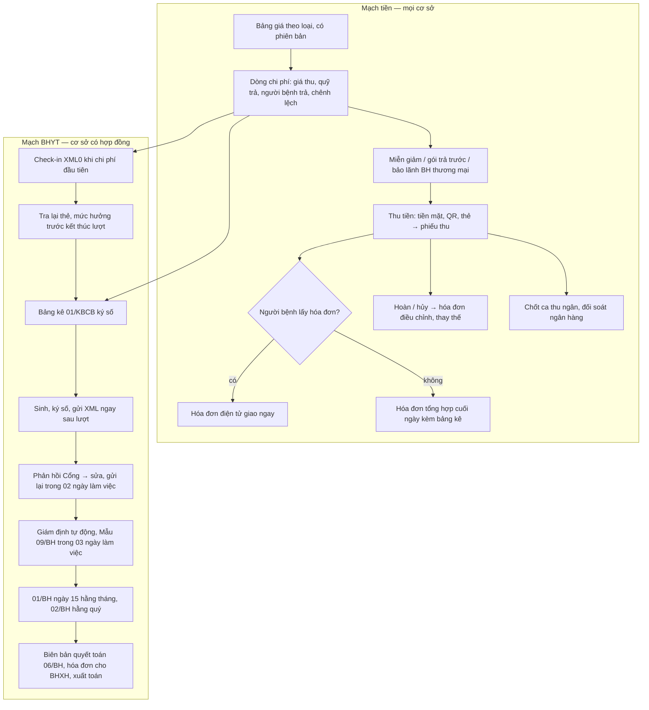

# Luồng tham chiếu: viện phí và BHYT ngoại trú (giá → tính tiền → thu → hóa đơn → XML → giám định → quyết toán)

> Kiểm tra lần cuối: 2026-10-27 · Áp dụng: phòng khám dịch vụ, phòng khám có hợp đồng BHYT, khoa khám bệnh bệnh viện, chuỗi phòng khám · Luật liên quan: TC-MS, BHYT-DATA, BHYT-GD, DLCN · Nhãn: xem `../variation-points.md`

Đây là nhánh B9 (và một phần B8) của `ngoai-tru.md`. Luồng có hai mạch chạy song song trên cùng một lượt: **mạch tiền** (giá, phiếu thu, hóa đơn, chốt ca) áp cho mọi cơ sở, và **mạch BHYT** (check-in, bảng kê, XML, giám định, quyết toán) chỉ áp cho cơ sở có hợp đồng BHYT. Hai mạch gặp nhau ở từng dòng chi phí: quỹ trả bao nhiêu, người bệnh trả bao nhiêu, chênh lệch bao nhiêu. Nội trú (tạm ứng nhiều lần, giường, quyết toán theo đợt dài) chưa làm trong đợt này.

## Sơ đồ tham chiếu

## Các bước — mạch tiền

### B1 — Bảng giá và danh mục giá
- **Vai**: kế toán/giá; ban giám đốc duyệt; CNTT nạp.
- **Đầu vào → ra**: văn bản giá (QĐ BYT, NQ HĐND, QĐ cơ sở) → danh mục giá có loại giá, nguồn thẩm quyền, ngày hiệu lực, mã DVKT.
- `[LUẬT]`: mỗi dòng giá có loại giá (BHYT; NSNN; ngoài danh mục BHYT không theo yêu cầu; theo yêu cầu), nguồn thẩm quyền, ngày hiệu lực; áp giá theo ngày thực hiện; không cài sẵn "bảng giá thống nhất toàn quốc"; cài sẵn bảng giá TT 22/2023 là dùng văn bản hết hiệu lực (`TC-MS-R17`). Niêm yết, kê khai giá; chặn hoặc đòi phê duyệt khi thu dịch vụ chưa niêm yết (`TC-MS-R19`). Cơ sở tư nhân có BHYT: giá tham chiếu là giá HĐND tỉnh phê duyệt cho cơ sở nhà nước trên địa bàn, chênh lệch người bệnh tự trả (`TC-MS-R18`). Dịch vụ phải ánh xạ mã DVKT BHYT và mã tương đương TT 23 (`BHYT-DATA-R17`).
- `[THÔNG LỆ]`: PK tư giữ bảng giá trong Excel, đổi giá bằng cách sửa đè; BV công có 2–4 bảng giá song song (BHYT, viện phí, theo yêu cầu, khám chuyên gia).
- `[HỎI]`: VP-VP-01 (bao nhiêu bảng giá? ai đổi? hiệu lực từ khi nào?), VP-VP-02 (giá BHYT lấy theo HĐND tỉnh nào?), VP-DM-01 (danh mục có bao nhiêu dòng, ai ánh xạ mã?).
- **Dấu hiệu lệch chuẩn**: sửa đè giá không giữ phiên bản; dòng thu "khác" không gắn dịch vụ; giá theo yêu cầu không có quyết định của cơ sở.

### B2 — Tính tiền từng dòng chi phí
- **Vai**: hệ thống; thu ngân kiểm tra.
- **Đầu vào → ra**: y lệnh/phiếu thực hiện + giá hiệu lực + mức hưởng → dòng chi phí với giá thu, phần quỹ trả, phần người bệnh cùng chi trả, phần người bệnh tự trả, chênh lệch.
- `[LUẬT]`: mọi khoản thu gắn dịch vụ thực tế và giá hiệu lực; dòng chi phí sinh từ y lệnh/phiếu thực hiện, sửa số lượng/đơn giá sau khi chốt chỉ qua phê duyệt có nhật ký (`TC-MS-R21`). Người bệnh được giải thích chi tiết chi phí khi có yêu cầu: bảng chi phí lũy kế theo dòng ở mọi thời điểm (`TC-MS-R20`). Lượt BHYT: tỷ lệ tiền khám khi khám nhiều chuyên khoa (100/30/10/0%) và tách chi phí theo thẻ, mức hưởng theo PL QĐ 697 (`BHYT-DATA-R21`); đơn giá làm tròn 3 chữ số thập phân, thành tiền 2 chữ số, tổng XML1 phải khớp chi tiết (`BHYT-DATA-R10`); mức hưởng theo cấp CMKT, đúng/không đúng nơi đăng ký, cấp cứu 100%, lộ trình 01/07/2026 (`BHYT-GD-R10`); miễn cùng chi trả khi đủ 5 năm liên tục và vượt ngưỡng lũy kế lấy từ Cổng, kể cả giữa lượt (`BHYT-GD-R09`); thẻ hết hạn giữa đợt: hưởng tối đa thêm 15 ngày (`BHYT-GD-R08`); xuất trình thẻ muộn: tách chi phí trước/sau mốc trừ cấp cứu (`BHYT-GD-R06`); dịch vụ theo yêu cầu/ngoài phạm vi: thông báo trước, lưu xác nhận, tách đúng `T_BNTT` với `T_BNCCT` (`BHYT-GD-R35`); nhóm hưởng 100% theo NQ 261: không có khoản thu tại quầy (`TC-MS-R22`, `BẮT BUỘC?`).
- `[THÔNG LỆ]`: PK-BHYT giải thích chênh lệch bằng miệng tại quầy; BV in "phiếu công khai" từng ngày cho nội trú, ngoại trú chỉ có bảng kê cuối lượt.
- `[HỎI]`: VP-KH-10 (khám 2–3 phòng/ngày tính một lượt hay nhiều, BHYT hợp nhất thế nào?), VP-KH-11 (ai báo giá chênh lệch cho người bệnh, lưu ở đâu?), VP-VP-03 (cơ sở xếp cấp nào, bao nhiêu điểm?).
- **Dấu hiệu lệch chuẩn**: thu ngân sửa tay số tiền trên bảng kê; dùng float cho đơn giá; tỷ lệ hưởng gõ tay; không có chỗ ghi nhận người bệnh đã được báo trước chi phí ngoài phạm vi.

### B3 — Tạm ứng, gói trả trước, miễn giảm, bảo lãnh bảo hiểm thương mại
- **Vai**: thu ngân; người duyệt miễn giảm; bộ phận bảo lãnh (nếu có).
- `[LUẬT]`: thu trước thì lập hóa đơn khi thu tiền, trừ đặt cọc theo Bộ luật Dân sự; tạm ứng viện phí là "thu trước" hay "đặt cọc" chưa có hướng dẫn, cấu hình theo ý kiến cơ quan thuế của cơ sở; gói trả trước luôn là thu trước (suy luận) (`TC-MS-R04`, `BẮT BUỘC?`). Chỉ gửi dữ liệu cho DNBH/TPA khi người bệnh yêu cầu bằng văn bản (điện tử được), đúng phạm vi và thời hạn, từng lần có nhật ký; luồng bảo lãnh khởi tạo từ yêu cầu của người bệnh, không gửi tự động (`TC-MS-R27`, `DLCN-R09`). Không in lại hóa đơn, bảng kê, giấy tờ với số liệu khác bản đã phát hành; bản in lại ghi "bản sao" (`TC-MS-R28`). Tách khoản phải thu theo bên trả, công nợ DNBH theo thư bảo lãnh (`TC-MS-R29`, NÊN). Người bệnh tự tải gói chứng từ bồi thường qua cổng/app ít nhất 01 năm (`TC-MS-R30`, NÊN).
- `[THÔNG LỆ]`: PK tư bán gói thai sản, gói liệu trình, thẻ thành viên giảm giá; nhân viên được giảm giá "theo ý giám đốc" qua chat; bảo lãnh viện phí thường qua email/cổng của TPA, nhân viên PK gửi hồ sơ khi người bệnh ký giấy ủy quyền in sẵn.
- `[HỎI]`: VP-VP-06 (có gói/liệu trình trả trước? hoàn tiền thế nào? đã hỏi cơ quan thuế về cách lập hóa đơn chưa?), VP-VP-07 (bảo lãnh với công ty nào? quy trình, ai gửi hồ sơ? ai được giảm giá, cần ai duyệt?).
- **Dấu hiệu lệch chuẩn**: gói trả trước chỉ có phiếu thu không có hóa đơn; gửi hồ sơ cho TPA theo điều khoản ủy quyền trong hợp đồng bảo hiểm mà không có yêu cầu riêng của người bệnh tới cơ sở (bẫy `TC-MS-R27`); giảm giá sửa thẳng đơn giá thay vì dòng giảm giá có người duyệt; in lại bảng kê với số khác.

### B4 — Thu tiền, phiếu thu, hoàn tiền
- **Vai**: thu ngân; người duyệt hoàn.
- **Đầu vào → ra**: dòng chi phí phải thu → phiếu thu (số, thời điểm, người thu, phương thức, liên kết lượt và dòng dịch vụ); khi hoàn: phiếu chi/hoàn và chứng từ điều chỉnh.
- `[LUẬT]`: mọi giao dịch thu đều có phiếu thu lưu trên hệ thống, gắn lượt và dòng dịch vụ (`TC-MS-R02`). Hỗ trợ thanh toán không tiền mặt là `NÊN`; phương thức thanh toán là trường bắt buộc trên phiếu thu (`TC-MS-R24`). Tiền phải đi thẳng vào tài khoản cơ sở; vendor không giữ tiền, không thu hộ, không làm cổng thanh toán khi không có giấy phép trung gian thanh toán (`TC-MS-R25`). Đối soát giao dịch ngân hàng ↔ phiếu thu 1–1; thiếu/thừa/hoàn xử lý bằng hóa đơn điều chỉnh (`TC-MS-R26`, NÊN). Hoàn viện phí → hóa đơn điều chỉnh giảm, không "hủy" (`TC-MS-R09`).
- `[THÔNG LỆ]`: PK tư thu trước khám và trước CLS; BV thu nhiều điểm (quầy khám, quầy CLS, quầy thuốc) rồi gộp. QR động theo từng phiếu thu đang thay dần QR tĩnh dán quầy. Hoàn tiền mặt cần giám đốc ký tay.
- `[HỎI]`: VP-TD-08 (thu khám lúc nào, CLS lúc nào, có cho nợ/gộp cuối lượt?), VP-VP-08 (hoàn cần ai duyệt? hoàn tiền mặt hay chuyển khoản?), VP-VP-12 (dùng cổng/ngân hàng nào? ai đối soát, bao lâu một lần?).
- **Dấu hiệu lệch chuẩn**: thu "ngoài sổ" ghi tay; phiếu thu không gắn dòng dịch vụ; QR tĩnh không đối soát được từng giao dịch; tiền khám qua app chảy về tài khoản của vendor/nền tảng rồi chuyển lại cho PK.

### B5 — Hóa đơn điện tử
- **Vai**: thu ngân; kế toán; hệ thống HĐĐT (nhà cung cấp hoặc tự làm).
- **Đầu vào → ra**: phiếu thu → hóa đơn điện tử giao ngay (nếu khách lấy) hoặc hóa đơn tổng hợp cuối ngày kèm bảng kê; hóa đơn điều chỉnh/thay thế khi sai hoặc hoàn.
- `[LUẬT]`: loại hóa đơn theo người bán: BV công (ĐVSNCL) mặc định có mã; doanh nghiệp y tế đủ hạ tầng được không mã; nhà thuốc là bán lẻ thuộc diện máy tính tiền trừ khi đã đăng ký HĐĐT thường (`TC-MS-R01`, có phần suy luận). Khách không lấy hóa đơn thì cuối ngày (ngày dương lịch) lập hóa đơn tổng hợp từ phiếu thu, không bỏ sót phiếu hủy/hoàn trong ngày; khách yêu cầu thì lập giao ngay; hóa đơn có mã chỉ coi là đã lập khi được cấp mã (`TC-MS-R02`). Nội dung: người mua ghi MST/mã ĐVQHNS/số định danh; mặc định "Bán cho người tiêu dùng"; dịch vụ KCB lập kèm bảng kê của người bán (khác bảng kê 01/KBCB); thuế suất theo mặt hàng (`TC-MS-R05`). Ký hiệu mẫu, ký hiệu theo năm, không tái dùng số (`TC-MS-R07`). Gửi người mua và cơ quan thuế đúng hạn; cổng tra cứu hóa đơn cho người bệnh không lộ thông tin bệnh án (`TC-MS-R08`). Hóa đơn sai: thông báo / điều chỉnh / thay thế, **không có nút hủy** sau khi gửi cơ quan thuế (`TC-MS-R09`). Hệ thống thuế hoặc nhà cung cấp lỗi: vẫn thu tiền và in phiếu thu, xếp hàng hóa đơn chờ, gửi bù trong 02/03 ngày làm việc, lưu nhật ký sự cố (`TC-MS-R10`). Lưu XML gốc đã ký, mã cơ quan thuế, phản hồi bất biến; bản chuyển đổi ra giấy có ghi chú (`TC-MS-R11`). Nhà thuốc dùng máy tính tiền: hóa đơn có mã tra cứu/QR, gửi dữ liệu cuối ngày, lỗi chỉ được thay thế (`TC-MS-R06`). Chuỗi/nền tảng lập hóa đơn hộ: ủy nhiệm theo hợp đồng, hiển thị cả hai bên (`TC-MS-R12`). Vendor tự làm giải pháp HĐĐT phải đủ điều kiện tổ chức cung cấp giải pháp, hoặc tích hợp nhà cung cấp có tên trên trang Cục Thuế (`TC-MS-R13`, `BẮT BUỘC?`). Phần BHYT **không** lập hóa đơn tại quầy (`TC-MS-R03`, xem B12).
- `[THÔNG LỆ]`: PK tư xuất hóa đơn qua nhà cung cấp HĐĐT (Viettel, VNPT, MISA, BKAV…) bằng cách nhập lại tay cuối ngày; nhiều HIS cũ còn nút "hủy hóa đơn"; hóa đơn tổng hợp cuối ngày ghi "khách lẻ không lấy hóa đơn".
- `[HỎI]`: VP-VP-05 (đang xuất hóa đơn kiểu gì? nhà cung cấp nào? có mã hay không mã? ai bấm lập hóa đơn tổng hợp?). Thêm: nhà thuốc trong cơ sở cùng pháp nhân hay khác? có điểm bán nào dùng máy tính tiền?
- **Dấu hiệu lệch chuẩn**: nút "hủy hóa đơn"; nhập lại tay từ HIS sang phần mềm HĐĐT; hóa đơn tổng hợp bỏ sót phiếu hoàn; HĐĐT lỗi thì không thu tiền hoặc thu không phiếu.

### B6 — Chốt ca thu ngân, đối soát ngày
- **Vai**: thu ngân; kế toán; trưởng ca.
- `[LUẬT]`: báo cáo đối chiếu ngày: tổng phiếu thu = hóa đơn cá nhân + hóa đơn tổng hợp ± điều chỉnh; cảnh báo khi job cuối ngày chưa chạy (`TC-MS-R02`). Giao dịch ngân hàng chưa có phiếu thu phải lộ ra trong báo cáo (`TC-MS-R26`, NÊN).
- `[THÔNG LỆ]`: 1–2 ca/ngày ở PK, 3 ca ở BV; chốt ca in bảng kê thu theo phương thức; tiền mặt bàn giao có chữ ký hai bên; chênh lệch nhỏ "bù sau".
- `[HỎI]`: VP-VP-13 (mấy ca/ngày? chốt ca cần in gì? ai nhận bàn giao? chênh lệch xử lý sao?).
- **Dấu hiệu lệch chuẩn**: không khóa phiếu thu sau chốt ca; sửa phiếu thu của ca trước; đối soát ngân hàng làm cuối tháng bằng tay.

## Các bước — mạch BHYT

### B7 — Điều kiện nền: hợp đồng, tài khoản Cổng, danh mục, chứng thư
- **Vai**: giám đốc/kế toán BHYT; CNTT; vendor cung cấp thông tin.
- `[LUẬT]`: điều kiện ký hợp đồng gồm bảo đảm kết nối, liên thông, xác thực dữ liệu; hồ sơ có bảng kê phần mềm, phần cứng Mẫu số 8 (`BHYT-GD-R15`). Một tài khoản quản trị Cổng cấp sau ký hợp đồng lần đầu (Mẫu 08/BH), không dùng chung; thông tin xác thực trong kho bí mật, mỗi lời gọi API ghi người dùng HIS và mã giao dịch (`BHYT-GD-R16`). Tài khoản HIS cá nhân, cấm mượn; `MA_BAC_SI` lấy từ tài khoản đăng nhập; kiểm phạm vi hành nghề và lịch làm việc (02/DM) trước khi cho chỉ định (`BHYT-GD-R17`). Danh mục sử dụng tại cơ sở Mẫu 01–06/DM: ký số, gửi Cổng, áp dụng từ ngày hợp đồng hiệu lực, thuốc/TBYT không sớm hơn hợp đồng mua sắm, chỉ dùng mục đã được Cổng chấp nhận tại ngày y lệnh, không update-in-place (`BHYT-DATA-R19`, `BHYT-GD-R28`). Mã cơ sở KCB 5 ký tự, quản lý có thời hạn khi sáp nhập/đổi tên (`BHYT-DATA-R24`). Chỉ dùng bộ mã dùng chung BYT có nguồn và ngày hiệu lực; mã loại hình KCB QĐ 1804 (16 mã), mã khoa QĐ 1804 PL02, mã đối tượng QĐ 3276 (`BHYT-DATA-R13`, `R14`, `R15`, `R16`). Ký số tổ chức từng hồ sơ XML, chứng thư đăng ký trên Cổng, cảnh báo hết hạn (`BHYT-GD-R18`, `BHYT-DATA-R07`).
- `[THÔNG LỆ]`: vendor hay giữ hộ tài khoản Cổng và chứng thư của PK nhỏ; danh mục 01–06/DM gửi một lần khi ký hợp đồng rồi quên cập nhật khi thêm bác sĩ, thêm dịch vụ.
- `[HỎI]`: VP-DM-01, VP-DM-02 (danh mục, thầu), VP-DM-04 (danh sách người hành nghề, bác sĩ thỉnh giảng có trong 02/DM không?), VP-DM-05 (bao nhiêu tài khoản, ai dùng chung?), VP-DM-06 (chuỗi: mỗi chi nhánh một mã cơ sở, một hợp đồng?). Thêm: ai giữ tài khoản Cổng và token ký số? có quy trình xoay mật khẩu khi đổi người?
- **Dấu hiệu lệch chuẩn**: `MA_BAC_SI` chọn từ combo box; dịch vụ kê trước ngày Cổng chấp nhận danh mục; chứng thư hết hạn không ai biết; một token ký số cắm cố định ở máy vendor.

### B8 — Check-in XML0
- **Vai**: hệ thống (tự động).
- `[LUẬT]`: gửi XML0 ngay sau khi phát sinh chi phí đầu tiên của lượt; không cần khi cấp cứu (`MA_DOITUONG_KCB = 2`) hoặc cơ sở chỉ nhận người bệnh/mẫu làm CLS; check-in chỉ thông báo trạng thái, không là căn cứ thanh toán; lưu `maGiaoDich` (`BHYT-DATA-R03`). Mã đối tượng ở XML0 là tạm, mã cuối xác định khi kết thúc lượt (`BHYT-DATA-R16`).
- `[THÔNG LỆ]`: nhiều HIS gửi check-in khi tiếp đón (trước khi có chi phí) hoặc gửi gộp cuối buổi.
- `[HỎI]`: chi phí đầu tiên của lượt ở cơ sở này là gì (tiền khám lúc tiếp đón hay dịch vụ đầu tiên sau khám)? Có trường hợp chỉ nhận mẫu làm CLS thuê không?
- **Dấu hiệu lệch chuẩn**: check-in gửi theo lô; không lưu mã giao dịch; không có check-in cho lượt chuyển vào điều trị ban ngày.

### B9 — Tra lại thẻ, chốt mức hưởng, xác định mã đối tượng khi kết thúc lượt
- **Vai**: thu ngân/kế toán BHYT; hệ thống.
- `[LUẬT]`: bắt buộc tra lại thẻ và quyền lợi trước khi kết thúc lượt; nhiều thẻ/mức thì lấy mức cao nhất; mức mới tính từ khi thẻ mới có giá trị (`BHYT-GD-R07`, `BHYT-GD-R02`). Lưu nguyên phản hồi tra cứu làm đầu vào bảng kê và `MUC_HUONG`; tra ra 2 mã thẻ thì dùng mã có hạn phù hợp thời điểm đến khám (`BHYT-DATA-R04`). `MUC_HUONG` 4 ký tự từ 01/07/2026, tách chi phí khi một đợt có hai mức (`BHYT-DATA-R11`, `BẮT BUỘC?`). Mã đối tượng KCB chọn theo thứ tự ưu tiên PL1 QĐ 3276 sau khi kết thúc lượt (`BHYT-DATA-R16`). Người bệnh bỏ về không làm thủ tục: người được thủ trưởng ủy quyền ký xác nhận chi phí, có lý do (`BHYT-GD-R33`). Cổng lỗi tới lúc kết thúc lượt: gửi BHXH hồ sơ kèm bằng chứng lỗi (`BHYT-GD-R03`). Nghi vấn thẻ (mượn, gian lận): báo BHXH, lưu bằng chứng (`BHYT-GD-R32`).
- `[THÔNG LỆ]`: PK-BHYT tra thẻ một lần lúc tiếp đón rồi thôi; BV có "quầy thanh toán BHYT" tra lại khi chốt.
- `[HỎI]`: VP-VP-04 (ai bấm tra lại? có bị bỏ qua khi đông không?), VP-VP-11 (người bệnh bỏ về có thường không? ai ký thay?).
- **Dấu hiệu lệch chuẩn**: không có bước tra lại; mức hưởng gõ tay; mã đối tượng chọn tay từ danh sách.

### B10 — Bảng kê 01/KBCB
- **Vai**: thu ngân; người bệnh ký; bác sĩ/người có thẩm quyền ký.
- `[LUẬT]`: mỗi lượt 01 bảng kê lưu, 01 giao người bệnh; đã có bệnh án điện tử thì bảng kê điện tử ký số đầy đủ, không phải lập giấy; bản giấy ký tay được scan và ký số cơ sở; chỉ kê mục phát sinh, giữ STT mã mục; nâng cấp phần mềm chậm nhất 01/07/2026; bảng kê và XML sinh từ **cùng một ảnh chụp dữ liệu** (`BHYT-DATA-R21`). Bảng kê 01/KBCB khác bảng kê kèm hóa đơn thuế (`TC-MS-R05` bẫy).
- `[THÔNG LỆ]`: in bảng kê giấy cho người bệnh ký tay rồi lưu; PK tư chưa có bệnh án điện tử vẫn dùng bản giấy.
- `[HỎI]`: VP-VP-10 (người bệnh ký bảng kê bằng gì — giấy, tablet, OTP?). Thêm: ai ký phía cơ sở trên bảng kê?
- **Dấu hiệu lệch chuẩn**: bảng kê và XML lệch số (sinh ở hai thời điểm); bảng kê in trước khi tra lại thẻ; ký tay rồi không scan/ký số cơ sở.

### B11 — Sinh, ký số, gửi XML; xử lý phản hồi Cổng
- **Vai**: hệ thống; kế toán BHYT/CNTT xử lý hồ sơ lỗi.
- **Đầu vào → ra**: lượt đã kết thúc, bảng kê đã chốt → bộ XML đúng phiên bản, ký số, gửi; phản hồi Cổng gắn hồ sơ.
- `[LUẬT]`: đủ bộ bảng theo loại lượt (XML1–3 luôn; XML4 khi có CLS; XML5 khi loại điều trị; XML7, 9, 10, 11, 13, 14 khi có chứng từ), đóng gói theo chuẩn Cổng, mỗi lần gửi một hồ sơ (`BHYT-DATA-R01`, `BHYT-DATA-R02`, `BHYT-DATA-R26`). `MA_LK` duy nhất, bất biến, không đổi khi gửi lại (`BHYT-DATA-R09`). Kiểm kiểu, độ dài, định dạng từng trường theo XSD trước khi gửi; lưu mã dạng chuỗi (`BHYT-DATA-R08`). ICD-10 TT 06/2026 chọn theo ngày kết thúc lượt, áp quy tắc cột 24–29 (`BHYT-DATA-R20`). Mã thuốc/VTYT/thầu đúng cú pháp; mã VTYT do Cổng cấp, không tự sinh (`BHYT-DATA-R18`). Ký số file XML bằng chứng thư cơ sở đã đăng ký, kiểm hạn trước khi ký (`BHYT-DATA-R07`, `BHYT-GD-R18`). Gửi **ngay sau khi kết thúc lượt**; kết thúc vào ngày nghỉ thì ngày làm việc kế tiếp; retry có backoff; lưu `maGiaoDich`, `thoiGianTiepNhan` (`BHYT-GD-R19`). Trong 07 ngày làm việc: kiểm tra, hiệu chỉnh, xác thực, gửi đề nghị thanh toán tới Cổng giám định **và** Cổng BYT; phát sinh cuối tháng/quý/năm gửi trước ngày 05 tháng sau (`BHYT-GD-R20`). Gửi chậm chỉ khi sự cố, có nhật ký và bằng chứng; thời gian Cổng ngừng được cộng vào hạn (`BHYT-GD-R21`). Phản hồi tự động của Cổng (06/24/48 giờ) ánh xạ về hồ sơ–bảng–trường; gửi bản điều chỉnh kèm văn bản trong 02 ngày làm việc (`BHYT-GD-R22`). Hiệu chỉnh/gửi lại/thay thế giữ mọi phiên bản đã gửi, dùng đúng phiên bản chuẩn và danh mục tại thời điểm KCB (`BHYT-DATA-R06`, `BHYT-DATA-R23`). Lưu biên nhận lâu dài vì Cổng chỉ tra 60 ngày (`BHYT-DATA-R22`). TLS, phân quyền, không để XML nơi công khai; XML6 (HIV) phân quyền chặt hơn (`BHYT-DATA-R25`). Hồ sơ bí mật nhà nước loại khỏi luồng gửi thường (`BHYT-GD-R31`). Không kết nối, liên thông là hành vi có chế tài (`BHYT-GD-R30`). Chuẩn bị cho dự thảo thay TT 48 (gửi trong 03 giờ, khóa sau đề nghị thanh toán) nhưng **không** viết đó là nghĩa vụ hiện hành (`BHYT-GD-R34`, NÊN).
- `[THÔNG LỆ]`: kế toán BHYT "đẩy XML" bằng tay cuối ngày hoặc cuối tuần; hồ sơ lỗi sửa trực tiếp trên file XML rồi gửi lại; quên gửi Cổng BYT (TT 48 Đ7 k1 c).
- `[HỎI]`: VP-VP-09 (hiện gửi ngay hay cuối ngày/cuối tháng? ai xử lý hồ sơ Cổng trả lỗi, mất bao lâu?). Thêm: có từng bị từ chối vì gửi trễ chưa? có lưu phản hồi không? sửa hồ sơ lỗi bằng cách nào?
- **Dấu hiệu lệch chuẩn**: sửa XML bằng tay; `MA_LK` đổi khi gửi lại; hồ sơ gửi lại dùng danh mục hiện tại thay vì danh mục tại ngày KCB; không có màn hình hồ sơ lỗi và hạn 02 ngày; chữ ký XML làm ở máy vendor.

### B12 — Giám định, tổng hợp, quyết toán, xuất toán
- **Vai**: kế toán BHYT; giám đốc; kế toán trưởng; BHXH.
- `[LUẬT]`: giám định tự động 11 nội dung, kết quả trong 07 ngày làm việc; cơ sở gửi tài liệu chứng minh hoặc Mẫu 09/BH trong 03 ngày làm việc (`BHYT-GD-R23`). Giám định chủ động: cung cấp trọn gói HSBA, y lệnh, kết quả CLS, hóa đơn trong 03 ngày làm việc; đối chiếu từng dòng XML2/XML3 với y lệnh và phiếu thực hiện (`BHYT-GD-R24`). 01/BH trong 15 ngày đầu tháng, 02/BH trong 15 ngày đầu quý, sinh từ đúng tập XML1 đã gửi, kiểm ràng buộc cột, ký số người lập/kế toán trưởng/thủ trưởng (`BHYT-GD-R25`). Biên bản giám định 03/BH và quyết toán 06/BH ký trong 02 ngày làm việc; hóa đơn điện tử cho BHXH khớp số quyết toán; chênh lệch sau quyết toán lập hóa đơn mới cho phần chênh; sổ xuất toán theo hồ sơ và lý do để khiếu nại (`BHYT-GD-R26`, `TC-MS-R03`). Dữ liệu chi phí trung thực, mỗi dòng truy vết tới y lệnh và phiếu thực hiện; cấm sửa trực tiếp số lượng/giá trên bảng kê; chế tài kê khống, kê tăng, áp sai giá (`BHYT-GD-R29`). Cảnh báo gia tăng chi của BHXH trước ngày 15 hằng tháng, cơ sở rà soát trong 10 ngày; công cụ phân tích chi bình quân là `NÊN` (`BHYT-GD-R27`).
- `[THÔNG LỆ]`: kế toán BHYT làm 01/BH bằng Excel từ file xuất HIS; xuất toán hạch toán "giảm doanh thu" cuối quý; không ai truy ngược xuất toán về bác sĩ chỉ định.
- `[HỎI]`: ai làm 01/BH, 02/BH, bằng công cụ gì? tỷ lệ xuất toán gần đây, lý do thường gặp? có muốn báo cáo chi theo bác sĩ/khoa không? hóa đơn cho BHXH ai lập, lúc nào?
- **Dấu hiệu lệch chuẩn**: 01/BH gõ tay; lập hóa đơn phần BHYT tại quầy; xuất toán không gắn hồ sơ; sửa số lượng trên bảng kê để "khớp" giám định.

## Biến thể theo loại cơ sở

| Khía cạnh | PK thuần dịch vụ | PK có hợp đồng BHYT (tư) | Khoa khám bệnh BV công | Chuỗi PK |
|---|---|---|---|---|
| Loại giá | Giá tự quyết, kê khai, niêm yết `[LUẬT]` | Giá tự quyết + giá tham chiếu HĐND cho phần BHYT `[LUẬT]` | 4 loại giá theo NĐ 96 `[LUẬT]` | Bảng giá chuỗi, có khác theo chi nhánh? `[HỎI]` |
| Thời điểm thu | Trước khám, trước CLS `[THÔNG LỆ]` | BHYT cuối lượt; dịch vụ trước `[THÔNG LỆ]` | Cuối lượt, nhiều điểm thu `[THÔNG LỆ]` | Theo chính sách chuỗi `[HỎI]` |
| Hóa đơn | DN: có mã hoặc không mã `[LUẬT]` | Như PK-DV; phần BHYT lập khi quyết toán `[LUẬT]` | ĐVSNCL: có mã (suy luận) `[LUẬT]` | Có thể ủy nhiệm lập hóa đơn tập trung (`TC-MS-R12`) |
| Nhà thuốc | Máy tính tiền nếu là bán lẻ (suy luận) | Như trái | Nhà thuốc BV | Nhà thuốc chuỗi pháp nhân riêng? `[HỎI]` |
| Mạch BHYT | Không | Toàn bộ B7–B12 `[LUẬT]` | Toàn bộ | Theo từng mã cơ sở, hợp đồng nhóm có thể tổng hợp chung (`BHYT-GD-R25`) |
| Gói trả trước | Phổ biến `[THÔNG LỆ]`, hóa đơn khi thu (`TC-MS-R04`, `BẮT BUỘC?`) | Ít | Hiếm ngoại trú | Phổ biến, dùng chéo chi nhánh `[HỎI]` |
| Bảo lãnh BH thương mại | Phổ biến ở PK tư lớn `[HỎI]` | Có | BV tư; BV công ít | Hợp đồng bảo lãnh cấp chuỗi `[HỎI]` |
| Thanh toán điện tử | QR động, thẻ `[THÔNG LỆ]` | Như trái | QR, thẻ, app BV | Qua nền tảng: xem `TC-MS-R25` |

## Điểm biến thiên của luồng này
VP-VP-01 → VP-VP-13, VP-TD-08, VP-CLS-02, VP-KH-10, VP-KH-11, VP-DM-01, VP-DM-02, VP-DM-04 → VP-DM-06 trong `../variation-points.md`.

## Dữ liệu và giấy tờ sinh ra
Danh mục giá có phiên bản · dòng chi phí (giá thu, quỹ trả, cùng chi trả, tự trả, chênh lệch, bên trả) · bản ghi thông báo trước chi phí ngoài phạm vi · phiếu thu, phiếu hoàn · hóa đơn điện tử (giao ngay, tổng hợp cuối ngày, điều chỉnh, thay thế, cho BHXH) kèm bảng kê người bán · báo cáo chốt ca, đối soát ngân hàng · phản hồi tra thẻ (3 thời điểm) · XML0 và `maGiaoDich` · bảng kê 01/KBCB ký số · bộ XML đã ký và mọi phiên bản gửi lại · phản hồi Cổng, văn bản điều chỉnh · Mẫu 09/BH · 01/BH, 02/BH · biên bản 03/BH, 06/BH · sổ xuất toán · yêu cầu bằng văn bản của người bệnh gửi DNBH và nhật ký cung cấp · danh mục 01–06/DM và trạng thái duyệt.

## Câu hỏi mở của chính luồng tham chiếu (chưa xác minh)
- Tạm ứng viện phí là "thu trước" hay "đặt cọc" theo NĐ 254: chưa có hướng dẫn thuế (`TC-MS-R04`).
- Nhóm hưởng 100% theo NQ 261 chi tiết: nguồn thứ cấp (`TC-MS-R22`).
- `MUC_HUONG` 4 ký tự và `SO_DANG_KY` thuốc hiếm theo QĐ 1931/2026: bản gốc chưa đọc (`BHYT-DATA-R11`, `BHYT-DATA-R12`).
- Định dạng chữ ký XML (XMLDSig?) và phạm vi ký: hướng dẫn BHXH chưa rõ số hiệu (`BHYT-DATA-R07`).
- Nghĩa vụ gửi XML chứng từ với người bệnh không dùng BHYT (`BHYT-DATA-R26`, `BẮT BUỘC?`).
- Tình trạng vận hành Cổng BYT nhận dữ liệu song song (`BHYT-GD-R20` bẫy).
- Dự thảo thay TT 48 (03 giờ): chưa ban hành (`BHYT-GD-R34`).
- Mô hình nền tảng thu tiền khám hộ PK có rơi vào "thu hộ, chi hộ" không: cần NHNN hoặc luật sư (`TC-MS-R25`).
