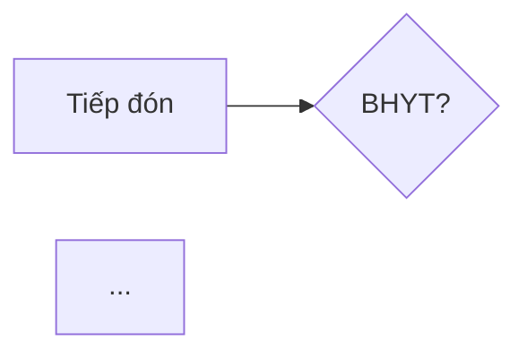

# Mẫu đầu ra của BA

> Kiểm tra lần cuối: 2026-10-27 · Nhãn `[LUẬT]` / `[THÔNG LỆ]` / `[HỎI]` và VP-id: `../business/variation-points.md` · ID luật (`EMR-R10`…): `../domains/*.md`

Quy tắc chung cho mọi mẫu:
1. **Mọi khẳng định nghiệp vụ có nhãn.** Không nhãn thì không viết.
2. **ID skill chỉ nằm ở cột "Truy vết"** hoặc dòng "Tham chiếu". Không đưa vào tiêu đề, câu văn, tóm tắt. Khách không biết `EMR-R10` là gì.
3. **Căn cứ luật viết đủ**: số hiệu + điều/khoản + link lấy từ bảng "1. Văn bản" của file domain. Không tự đoán URL.
4. **Tóm tắt không chắc hơn chi tiết.** Chưa xác nhận thì tóm tắt ghi chưa xác nhận; `BẮT BUỘC?` thì ghi rủi ro.
5. Mỗi tài liệu có đầu trang: tên cơ sở, phiên bản, ngày, người lập, trạng thái (nháp / đã khách xác nhận), ngày "Kiểm tra lần cuối" của skill.
6. Viết bằng ngôn ngữ của người đọc (chủ cơ sở, bác sĩ, dev), không phải ngôn ngữ của skill.

---

## (1) Báo cáo khảo sát

**Hướng dẫn**: lập sau C5 trong `../elicitation/khao-sat.md`. Người đọc là chủ cơ sở và đội dự án; đọc 10 phút phải biết cơ sở này là gì, luồng chạy sao, chỗ nào chưa rõ, chỗ nào có rủi ro. Phần lệch luật chỉ đưa vào khi đã có buổi giải thích (vòng D) hoặc chủ yêu cầu.

```
# Báo cáo khảo sát — <Tên cơ sở>
Phiên bản · Ngày khảo sát · Người khảo sát · Người được phỏng vấn (vai, không cần tên) · Trạng thái · Skill kiểm tra lần cuối: <ngày>

## 1. Tóm tắt điều hành (≤ 10 dòng)
- Loại cơ sở, quy mô (lượt/ngày, % BHYT, số phòng, số bác sĩ)
- Mục tiêu dự án theo lời chủ
- 3–5 phát hiện quan trọng nhất (mỗi dòng ghi rõ: đã xác nhận / chưa xác nhận / rủi ro pháp lý)
- Mức độ đầy đủ của khảo sát: n/m điểm biến thiên đã trả lời; vai chưa gặp

## 2. Hồ sơ cơ sở
Loại · BHYT (cấp CMKT, điểm) · CLS tại chỗ · quầy thuốc · điều trị theo đợt · chi nhánh · phần mềm hiện tại · hạ tầng · chứng thư số

## 3. Luồng as-is
→ chèn mẫu (2), phần as-is

## 4. Số liệu vận hành
Lượt/ngày theo loại · giờ cao điểm · thời gian chờ · hồ sơ Cổng lỗi/tháng · hoàn tiền/tuần · xuất toán kỳ gần nhất

## 5. Điểm đau theo vai (nguyên văn, có vai người nói)

## 6. Bảng điểm biến thiên đã điền
→ chèn mẫu (5), cột "Câu trả lời khách" và "Trạng thái"

## 7. Giả định và câu hỏi mở
→ chèn mẫu (8)

## 8. Rủi ro tuân thủ phát hiện sớm (chỉ mục có bằng chứng + căn cứ)
| Hiện trạng (nguyên văn/ảnh) | Căn cứ (số hiệu, điều, link) | Mức | Hệ quả thực tế | Hướng xử lý | Truy vết |

## 9. Phạm vi chưa khảo sát
Bước, vai, chi nhánh, ca làm việc chưa đi; tài liệu chưa nhận

## 10. Bước tiếp theo
Vòng xác nhận · người cần gặp thêm · tài liệu còn thiếu · ngày dự kiến chốt as-is
```

---

## (2) Luồng as-is / to-be

**Hướng dẫn**: as-is chỉ chứa thứ khảo sát ghi nhận; bước không khảo sát ghi "chưa khảo sát". To-be lập sau khi có gap analysis; mỗi thay đổi so với as-is phải chỉ được về một gap (mẫu 3). Dùng tên bước của luồng tham chiếu (B0–B9) để so sánh được; bước riêng của khách đặt tên B<n>' và ghi chú.

````
## Luồng <as-is | to-be>: <tên luồng> — <cơ sở>
Phiên bản · Ngày · Nguồn (vai, ngày phỏng vấn) · Trạng thái xác nhận



| Bước | Vai | Công cụ hiện tại | Dữ liệu vào → ra | Ràng buộc luật (truy vết) | Số liệu | Điểm đau (nguyên văn) | Đề xuất (chỉ to-be) | Nguồn |
|---|---|---|---|---|---|---|---|---|
| B1 Tiếp đón | Lễ tân | PM X + sổ | CCCD/SĐT → hồ sơ, phiếu khám | Định danh bằng số định danh `[LUẬT]` (SKDT-R04) | 120 lượt/ngày | "bệnh cũ gõ SĐT cho nhanh" (lễ tân) | — | Lễ tân A, 27/10 |
| B2' Duyệt giảm giá | Quản lý | Zalo | yêu cầu → OK miệng | — | ~5/ngày | — | — | Thu ngân, 27/10 |

### Nhánh ngoại lệ đã ghi nhận
(bỏ về, Cổng lỗi, hoàn tiền, bổ sung thẻ sau…) — mỗi nhánh: kích hoạt khi nào, ai xử lý, tần suất, nguồn

### Khác biệt as-is ↔ to-be (chỉ ở bản to-be)
| Bước | Thay đổi | Lý do (gap #) | Ai bị ảnh hưởng | Cần đào tạo/đổi quy trình? |
````

---

## (3) Gap analysis ba chiều

**Hướng dẫn**: đặt cạnh nhau bốn cột: khách đang làm gì (as-is), luồng tham chiếu nói gì (nhãn), luật nói gì (ID), phần mềm hiện có làm được gì (từ audit theo `../audit-procedure.md` hoặc từ tài liệu sản phẩm). Mỗi khác biệt là một gap. Phân loại gap quyết định hướng xử lý; đừng mặc định "sửa phần mềm". Khuyến nghị phải có lý do bằng tiền, thời gian hoặc rủi ro.

Loại gap:
- **Lệch luật** — khách hoặc phần mềm đang làm trái `[LUẬT]`. Hướng xử lý không có lựa chọn "giữ nguyên".
- **Thiếu tính năng** — luồng khách hợp lệ nhưng phần mềm chưa làm được.
- **Khác thông lệ** — khách làm khác `[THÔNG LỆ]`, không sai luật; cân nhắc có đáng hỗ trợ không.
- **Đặc thù** — `[HỎI]` đã có câu trả lời, phần mềm cần linh động ở điểm này.

```
# Gap analysis — <cơ sở> × <phần mềm, phiên bản>
Phiên bản · Ngày · Nguồn as-is (đã xác nhận ngày…) · Nguồn phần mềm (audit ngày… / tài liệu…)

## Tóm tắt
Lệch luật: n (nghiêm trọng m) · Thiếu tính năng: n · Khác thông lệ: n · Đặc thù: n
3–5 gap phải xử lý trước go-live, mỗi dòng kèm hạn pháp lý nếu có

## Danh sách gap
### G-01 <tên gap bằng lời thường>
- Loại: Lệch luật | Thiếu tính năng | Khác thông lệ | Đặc thù
- Khách đang làm: … (nguồn)
- Luồng tham chiếu: … `[LUẬT|THÔNG LỆ|HỎI]`
- Luật: <số hiệu, điều/khoản, link> · Mức: BẮT BUỘC | BẮT BUỘC? | NÊN · Hạn: …   (bỏ dòng nếu không liên quan luật)
- Phần mềm hiện có: làm được / một phần / không (bằng chứng: màn hình, file:dòng, tài liệu)
- Hướng xử lý:
  | Hướng | Mô tả | Chi phí/thời gian ước | Rủi ro | Ảnh hưởng người dùng |
  |---|---|---|---|---|
  | A. Cấu hình | … | | | |
  | B. Sửa/thêm tính năng | … | | | |
  | C. Đổi quy trình khách | … | | | |
- Khuyến nghị: <A|B|C hoặc kết hợp> vì …
- Truy vết: <ID luật>, <VP-id>

## Bảng tổng hợp
| # | Gap | Loại | Mức | Hạn | Khuyến nghị | Ưu tiên | Truy vết |

## Gap không xử lý trong phạm vi này và lý do
## Chưa đủ thông tin để kết luận (câu hỏi gửi khách / cần audit thêm)
```

---

## (4) User story + acceptance criteria + truy vết

**Hướng dẫn**: mỗi story giải quyết ≥ 1 gap. Story của gap "Lệch luật" có AC bắt buộc chép đúng số liệu luật (thời hạn, định dạng, giới hạn) từ file domain, không rút gọn. Cột "Lớp" cho dev biết story này có được làm thành tùy chọn bật/tắt không: `[LUẬT]` → không có công tắc tắt; `[HỎI]`/`[THÔNG LỆ]` → thường là điểm cấu hình. Không mô tả cách hiện thực (bảng, API).

```
### US-<n> — <tên ngắn bằng lời thường>
Là <vai>, tôi muốn <việc>, để <giá trị>.
- Lớp: [LUẬT] | [THÔNG LỆ] | [HỎI] · Gap: G-xx · Ưu tiên: … · Hạn pháp lý: … (nếu có)
- Bối cảnh khách: <câu trả lời khảo sát liên quan, nguyên văn nếu có>

Acceptance criteria
- AC1. Given <trạng thái> When <hành động> Then <kết quả đo được>
- AC2. Given đơn thuốc đã gửi Hệ thống đơn thuốc quốc gia When bác sĩ chọn sửa Then hệ thống không cho sửa nội dung, chỉ cho kê đơn mới thay thế và đơn cũ chuyển trạng thái "đã thay thế"
- AC-ngoại lệ. Given <sự cố/ngoại lệ> When … Then …

Ngoài phạm vi: …
Câu hỏi mở: … (trỏ mẫu 8)
Truy vết: DUOC-R09 · VP-DT-02
```

Bảng tổng hợp story:

| US | Tên | Vai | Lớp | Gap | Truy vết luật | Truy vết VP | Ưu tiên | Hạn pháp lý |
|---|---|---|---|---|---|---|---|---|

---

## (5) Bảng điểm biến thiên bàn giao cho đội thiết kế

**Hướng dẫn**: đây là đầu ra chính skill này giao cho người thiết kế phần mềm. Nó nói **cái gì** phải linh động và cái gì không, kèm câu trả lời thật của khách; không nói **làm sao** (cấu hình, engine, plugin là việc của đội thiết kế). Lấy từ bảng VP của dự án sau vòng xác nhận; chỉ giao khi mọi dòng `[LUẬT]` đã có trạng thái.

```
# Điểm biến thiên — <cơ sở> — bàn giao thiết kế
Phiên bản · Ngày · Dựa trên as-is xác nhận ngày … · Skill kiểm tra lần cuối: …

| VP-id | Điểm biến thiên | Lớp | Câu trả lời của khách (nguyên văn/tóm tắt) | Nguồn (vai, ngày) | Trạng thái | Ý nghĩa cho thiết kế | Truy vết luật |
|---|---|---|---|---|---|---|---|
| VP-TD-08 | Thu tiền khám trước/sau | [THÔNG LỆ] | "Dịch vụ thu trước, BHYT thu cuối" | Thu ngân, 27/10 | Đã xác nhận | Điểm cấu hình theo loại đối tượng | TC-MS-R02 |
| VP-VP-04 | Tra lại thẻ trước kết thúc | [LUẬT] | Hiện không làm | Kế toán BHYT, 27/10 | Đã xác nhận (lệch luật, G-03) | Bắt buộc, không có công tắc tắt | BHYT-GD-R07 |
| VP-TD-03 | Kênh đặt hẹn | [HỎI] | — | — | Chưa xác nhận | Chưa thiết kế chi tiết; giữ chỗ | — |

Trạng thái: Đã xác nhận · Mâu thuẫn (ghi cả hai) · Chưa xác nhận · Không áp dụng (lý do)

## Tóm tắt cho đội thiết kế
- Số điểm [LUẬT]: n (trong đó khách đang lệch: m) — không được làm thành tùy chọn
- Số điểm [THÔNG LỆ]/[HỎI] đã có câu trả lời: n — ứng viên điểm cấu hình
- Số điểm chưa xác nhận: n — không thiết kế cứng, chờ khách
```

---

## (6) Kịch bản UAT nghiệp vụ

**Hướng dẫn**: UAT chạy theo luồng, bằng người dùng thật của khách, trên dữ liệu giống thật (danh mục, bảng giá của chính họ). Mỗi kịch bản trỏ về story/gap. Bộ "ca bắt buộc theo luật" phải có trong mọi UAT ngoại trú dù khách không yêu cầu; kết quả mong đợi của các ca này chép từ file domain. Kịch bản thất bại ở ca `[LUẬT]` là chặn go-live.

```
# UAT — <cơ sở> — <luồng>
Phiên bản · Ngày · Môi trường · Dữ liệu (danh mục/bảng giá phiên bản…) · Người thực hiện theo vai

| Mã | Kịch bản | Vai thực hiện | Tiền điều kiện | Các bước | Kết quả mong đợi | Lớp | Truy vết | Kết quả | Ghi chú |
|---|---|---|---|---|---|---|---|---|---|
```

Ca bắt buộc theo luật cho luồng ngoại trú (tối thiểu):

| Mã | Kịch bản | Kết quả mong đợi | Truy vết |
|---|---|---|---|
| UAT-L01 | Tiếp đón người bệnh chỉ có VNeID, không thẻ giấy | Tiếp nhận được, không bắt buộc ảnh/scan thẻ | BHYT-GD-R01 |
| UAT-L02 | Tiếp đón người không BHYT | Vẫn phải nhập số định danh; lượt sau đó vẫn sinh gói Sổ SKĐT | SKDT-R04, SKDT-R01 |
| UAT-L03 | Trẻ sơ sinh chưa có số định danh, sau đó có | Tạo được mã tạm; gộp hồ sơ có ghi vết | SKDT-R11, SKDT-R13 |
| UAT-L04 | Tra thẻ khi tiếp đón, Cổng lỗi | Có đường dự phòng, lưu lại để tra sau | BHYT-GD-R02, BHYT-GD-R03 |
| UAT-L05 | Điều dưỡng nhập hộ, bác sĩ ký | Hồ sơ lưu đúng người ghi và người ký, thời gian do hệ thống cấp | EMR-R04, EMR-R06 |
| UAT-L06 | Sửa nội dung bệnh án đã ký | Không sửa đè; bản cũ còn, có lý do, có người sửa | EMR-R10 |
| UAT-L07 | Chẩn đoán nhập tự do không chọn ICD | Không cho kết thúc lượt | MA-LT-R01 |
| UAT-L08 | Chỉ định dịch vụ ngoài danh mục được duyệt | Bị chặn hoặc cảnh báo theo cấu hình đã thống nhất, có ghi nhận | MA-LT-R14 |
| UAT-L09 | Chỉ định dịch vụ theo yêu cầu cho người có thẻ | Hiển thị phần chênh lệch, lưu xác nhận người bệnh trước khi thực hiện | BHYT-GD-R35, TC-MS-R18 |
| UAT-L10 | Kê đơn, gửi Hệ thống đơn thuốc quốc gia | Mã đơn 14 ký tự đúng quy tắc; gửi ngay khi kết thúc khám; trạng thái gửi xem được | DUOC-R04, DUOC-R12 |
| UAT-L11 | Sửa đơn đã gửi | Bị chặn; chỉ kê đơn mới thay thế | DUOC-R09 |
| UAT-L12 | Kê thuốc gây nghiện cùng đơn thuốc thường | Bị tách đơn riêng theo quy tắc | DUOC-R07 |
| UAT-L13 | Cấp phát thuốc tại quầy | Phải đối chiếu đơn; lô hết hạn bị chặn; lưu người cấp, thời gian | DUOC-R20 |
| UAT-L14 | Kết thúc lượt BHYT | Bắt tra lại thẻ/mức hưởng; XML vào hàng đợi gửi ngay; bảng kê 01/KBCB điện tử ký số | BHYT-GD-R07, BHYT-GD-R19, BHYT-DATA-R21 |
| UAT-L15 | Chi phí đầu tiên của lượt BHYT phát sinh | Check-in XML0 được gửi | BHYT-DATA-R03 |
| UAT-L16 | Thu tiền mặt một dịch vụ | Có phiếu thu; cuối ngày phiếu thu chưa lấy hóa đơn vào hóa đơn tổng hợp | TC-MS-R02 |
| UAT-L17 | Hoàn tiền dịch vụ đã xuất hóa đơn | Hóa đơn điều chỉnh/thay thế, không xóa | TC-MS-R09 |
| UAT-L18 | Người bệnh bỏ về không ký bảng kê | Có trạng thái riêng; người được ủy quyền ký thay, có lý do | BHYT-GD-R33 |
| UAT-L19 | Cấp giấy nghỉ hưởng BHXH 35 ngày không lý do đặc biệt | Bị chặn (tối đa 30 ngày/lần); đúng mẫu; gửi XML11 | GIAYTO-R12 |
| UAT-L20 | Phát hành phiếu hẹn khám lại, dùng lần hai | Lần hai bị từ chối; phiếu có hai chữ ký số | BHYT-GD-R12, GIAYTO-R17 |
| UAT-L21 | Tra nhật ký ai đã xem một hồ sơ | Có bản ghi xem, không sửa/xóa được | EMR-R12 |
| UAT-L22 | Gửi dữ liệu người bệnh cho công ty bảo hiểm khi chưa có yêu cầu bằng văn bản của người bệnh | Bị chặn | DLCN-R09, TC-MS-R27 |

---

## (7) Change request có đánh giá tác động pháp lý

**Hướng dẫn**: dùng khi khách xin thay đổi sau khi đã chốt as-is/story. Việc đầu tiên là xếp lớp cho yêu cầu; nếu chạm `[LUẬT]` theo hướng làm yếu đi thì câu trả lời là "không, và đây là cách hợp lệ" (xem bảng "đặc thù hay xin mà thực ra lệch luật" trong `variation-points.md`). Không ước lượng công sức trước khi xếp lớp.

```
# CR-<n> — <tên>
Ngày · Người yêu cầu (vai) · Nguyên văn yêu cầu · Lý do khách nêu

## Phân loại
- Lớp chạm tới: [LUẬT] | [THÔNG LỆ] | [HỎI] · VP-id liên quan · Story/gap bị ảnh hưởng
- Nếu chạm [LUẬT]: làm mạnh hơn hay yếu đi nghĩa vụ? Căn cứ: <số hiệu, điều, link> · Mức · Hạn

## Đánh giá tác động
| Khía cạnh | Tác động |
|---|---|
| Pháp lý | Không / Có — mô tả; chế tài hoặc hệ quả (xuất toán, chặn cấp phép…) |
| Nghiệp vụ | Bước nào đổi, vai nào bị ảnh hưởng |
| Dữ liệu đã có | Hồ sơ cũ xử lý sao |
| Tích hợp bên ngoài | Cổng BHYT, đơn thuốc QG, Sổ SKĐT, HĐĐT có đổi không |
| Lịch và chi phí | ước lượng từ đội kỹ thuật (không điền hộ) |

## Phương án
A. Làm theo yêu cầu · B. Làm cách khác đạt cùng mục đích và hợp lệ · C. Từ chối
Khuyến nghị và lý do

## Quyết định
Người quyết (theo ủy quyền của chủ) · Ngày · Kết quả · Cập nhật vào: as-is/to-be, bảng VP, story, UAT

Truy vết: …
```

---

## (8) Bảng giả định và câu hỏi mở

**Hướng dẫn**: đi kèm mọi tài liệu khác; đây là chỗ chứa mọi thứ chưa được khách xác nhận. Giả định được xác nhận thì chuyển sang tài liệu chính kèm nguồn, không xóa dòng (đổi trạng thái). Không có dòng nào trong tài liệu chính được viết chắc nếu nó còn nằm ở đây với trạng thái mở.

```
## Giả định
| # | Giả định | Lớp | Dựa trên | Hệ quả nếu sai | Ai xác nhận được | Trạng thái | Ngày |
|---|---|---|---|---|---|---|---|
| A-01 | Thu tiền khám trước với lượt dịch vụ | [THÔNG LỆ] | Mặc định thông lệ PK tư | Luồng thu ngân và màn hình tiếp đón đổi | Thu ngân / chủ | Mở | |

## Câu hỏi mở (gom theo vai)
| # | Câu hỏi | Vai trả lời | Vì sao cần (VP-id / gap / story) | Hạn cần | Trạng thái |

## Điểm pháp lý chưa rõ (từ mục "Chưa xác minh" của domain liên quan)
| # | Vấn đề | Mức hiện tại | Nên hỏi ai (Sở Y tế, BHXH, cơ quan thuế, luật sư) | Ảnh hưởng tới story nào |
```
